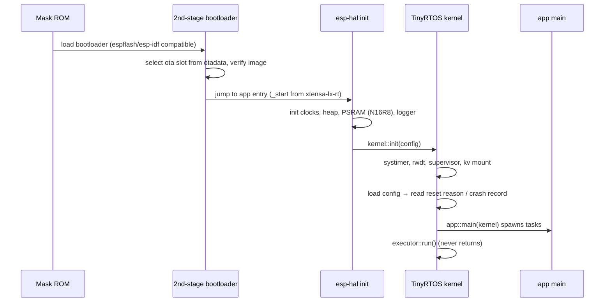

# Architecture

**Status:** draft v0.1 · 2026-09-21
Companion to [PLAN.md](PLAN.md). This document is the design the phases implement.

---

## 1. Layers and dependency rule

```
L5  apps/            sensor-node, actuator-node, gateway, examples
L4  services         provisioning · mqtt/discovery · ota · telemetry · time
L3  drivers          gpio · button · i2c · pwm · adc · onewire · sensors
L2  kernel (TinyRTOS) tasks · time · sync · event bus · kv · power · supervisor
L1  hal / arch       traits + esp-hal glue + board pin maps (per chip)
L0  silicon          esp32s3 · esp32c6 · host (mock)
```

**Rule:** dependencies only point down. `esp-sdk-kernel` depends on `esp-sdk-hal` traits, never on
`esp-sdk-net` or `esp-sdk-services`. `esp-sdk-hal` itself contains no chip-specific code; it defines
traits and re-exports the subset of `esp-hal` types that leak through (`Instant`, `Error`, GPIO
handles). Only `esp-sdk-arch-*` may `use esp_hal::…` directly. This is what lets the kernel compile
for `x86_64` and what makes the C6 port a matter of one new crate.

```
esp-sdk-hal        traits, no_std, no esp-hal  (compiles on host)
esp-sdk-arch-*     impls; depends on esp-hal, esp-radio, board pin map
esp-sdk-boot       partitions · otadata · image verification · crash record
esp-sdk-kernel     depends on esp-sdk-hal only
esp-sdk-drivers    depends on esp-sdk-kernel + esp-sdk-hal
esp-sdk-net        depends on drivers + kernel
esp-sdk-services   depends on net + kernel
esp-sdk-smarthome  depends on services (pure logic, host-testable)
```

---

## 2. Boot sequence



Key points:

- **Bootloader and partition table stay ESP-IDF compatible.** We use the standard 2nd-stage
  bootloader so `espflash`, OTA and factory recovery all keep working. We do not write our own
  bootloader in v1.
- **`main` returns `!`** and hands control to the executor. There is no "super loop".
- **Crash record** is written before reset in the panic handler and read back on the next boot;
  three consecutive abnormal boots enter safe mode (no app tasks, provisioning AP only).

### 2.1 Bootloader: buy or build

The boot chain has three stages, and only the middle one is ours to lose:

| Stage | Who provides it | Replaceable | What it does |
|---|---|---|---|
| 1. Mask ROM | Espressif silicon | never | reads flash at 0x0, verifies header, hands over to stage 2; also the UART/USB download mode that unbricks the board |
| 2. Bootloader | ESP-IDF binary, ~21 KB, bundled in `espflash` at 0x0 | **yes** | flash + PSRAM/clock init, partition table, `otadata` slot selection, image checksum/SHA-256/signature check, rollback flag, jump to app |
| 3. App | us (`esp-hal` + TinyRTOS) | of course | everything the product does |

**v1 decision (ADR-009): buy stage 2, own everything that decides what runs.** Concretely:

- The prebuilt IDF bootloader stays, because slot selection, image validation, rollback and the
  secure-boot/encryption hooks are already written and tested. Reimplementing them is a month of
  work whose failure mode is a bricked node.
- We own the **app-side** boot contract: partition table, `otadata` writes, "image pending verify"
  / "valid" marking, crash record in RTC RAM, safe mode. That is the code that actually decides
  whether a field update survives — see `esp-sdk-boot` in the crate layout.
- **Rollback is not free even with the IDF bootloader**: it only works if the bootloader was built
  with `CONFIG_BOOTLOADER_APP_ROLLBACK_ENABLE=y`, and the prebuilt images widely used with
  `espflash` do not have it. Phase 0 verifies this; if disabled, `xtask bootloader` builds one
  once (IDF v5.5 is already installed here) and flashes it at 0x0. This is also the bug in
  `smart_home_idf` today — its `sdkconfig` has rollback disabled.
- **App images stay ESP-IDF format** (`esp_bootloader_esp_idf::esp_app_desc!`, segment layout,
  checksum/sha256). That single constraint is what keeps "build our own bootloader later" cheap.

**What building our own would buy, and cost** (the Phase 6 spike):

| | Buy (IDF) | Build (Rust) |
|---|---|---|
| Effort to first boot | 0 | ~1 week (ROM → our code → hello) |
| Effort to production | 0 | ~3–5 weeks: image parsing, MMU/cache mapping, `otadata`, PSRAM init, watchdog, logging, tooling |
| Size budget | 21 KB in a 32 KB slot | ~32 KB unless `PARTITION_TABLE_OFFSET` is moved (it is configurable, at the cost of both bootloader and app agreeing on the new offset) |
| Secure boot / flash encryption | inherited | lost unless reimplemented — realistically never |
| Boot time | ~30–50 ms | ~10–15 ms; irrelevant for a mains-powered smarthome node, relevant for a coin-cell sensor |
| Failure mode | none, it is field-proven | boot loop = physical recovery via ROM download mode (GPIO0 + reset), so recoverable but not remotely |
| Ownership / learning | low | high |

Recommendation: keep the IDF bootloader through v1.0, keep the app image IDF-compatible, and
revisit only if the Phase 5 measurements show a concrete cost (boot time on battery nodes, or a
feature the IDF bootloader cannot express). A "no 2nd stage at all" design — app at 0x0 — is
deliberately rejected: it gives up OTA and partitioning to save one flash read.

---

## 3. Kernel design

### 3.1 Tasks

- Static only: `TaskSpec { name, stack_bytes, priority, entry }`, compiled into a `const` table per
  app. No dynamic task creation, no allocator.
- Backed by `embassy-executor` task pools, one per priority class:
  `Prio::High` (control loops, button), `Prio::Normal` (services), `Prio::Low` (telemetry, housekeeping).
  Each class is a separate executor; a low-priority task cannot delay a high-priority wake.
- Task metadata (name, stack watermark, heartbeat deadline) lives in a static array, readable by the
  `tasks` console command and published as diagnostics.
- Stack sizes are explicit: default 4 KiB, minimum 2 KiB, and the watermark check runs after every
  soak test. Xtensa has no hardware stack-overflow guard — the watermark is the guard.
- Cooperative: a task yields at every `.await`. The kernel does not preempt. The contract is in
  [ADR-002](PLAN.md#2-decision-log): blocking > 1 ms in executor context is a bug, caught by the
  watchdog and by code review.

### 3.2 Time

- `Instant` = 64-bit microseconds from SYSTIMER, monotonic across the whole uptime; `Duration` =
  `core::time::Duration`. `embassy-time` driver installs the same clock as the async time source.
- Wall clock = monotonic + offset, offset refreshed by SNTP and persisted in RTC RAM across resets.
- Tickless: no periodic tick interrupt. The timer comparator is armed for the next deadline only,
  which is what makes light sleep possible.

### 3.3 Synchronisation

| Primitive | Use | ISR-safe |
|---|---|---|
| `Mutex<T>` | shared state, short critical sections | no (signal only) |
| `Channel<T, N>` | ISR → task, driver → service | yes (send) |
| `Signal` | one-shot wake (button pressed, packet ready) | yes |
| `PubSub<T, N>` | event fan-out to N subscribers | yes (publish) |
| `AtomicU32` + `Waker` | counters, flags | yes |

All wrappers document their blocking behaviour and their ISR contract. `critical-section` is
implemented per arch (interrupt-free section on single core; spin-lock + interrupt masking across
cores on S3).

### 3.4 Event bus

Typed topics, no strings at runtime:

```rust
pub enum Event {
    Wifi(WifiEvent),
    Mqtt(MqttEvent),
    Button { id: ButtonId, action: ButtonAction },
    Sensor { id: SensorId, reading: Reading },
    ConfigChanged,
    OtaProgress { pct: u8 },
    Fault(FaultCode),
}
```

`BUS.publish(Event)` is non-blocking and drops the oldest message when a subscriber is slow, except
for `Fault` and `OtaProgress`, which use dedicated reliable channels. Rationale: telemetry storms
must never stall control.

### 3.5 KV store

- Dedicated `kv` partition (128 KiB), 4 KiB sectors, append-only log of `(key, seq, len, crc, value)`
  records with compaction when the log passes 75 %.
- API: `get<T: Deserialize>`, `set<T: Serialize>` (atomic commit: write, fsync, then superblock
  bump), `delete`, `iter`. Values are `postcard`-encoded; capacity per value 1 KiB.
- Namespaces: `net/`, `mqtt/`, `dev/`, `cal/`, `ota/`. Namespace wipe is the recovery path.
- Secrets (WiFi PSK, MQTT password) are stored in the same partition in v1, with a documented
  limitation: no flash encryption yet. Phase 5 evaluates NVS encryption / eFuse-backed keys.

### 3.6 Power

- Idle hook: executor finds no ready task → arm next deadline → light sleep. WiFi modem sleep is
  enabled once connected and configurable per app profile.
- Battery profile (Phase 5): deep sleep between reports, wake on timer or GPIO, state restored from
  RTC RAM. This is an app profile, not a kernel mode.
- All drivers expose `suspend()`/`resume()` so sleep does not leave a bus half-clocked.

### 3.7 Supervisor

- RWDT fed by the high-priority executor only, timeout 10 s. A task that hogs the executor trips it.
- Heartbeat registry: each task declares a max period; a monitor task flags a hung service and
  resets deliberately (clean reboot) before the watchdog does it dirty.
- Panic handler: write `CrashRecord { pc, task, reason, reset_count, uptime }` to RTC RAM, flush
  defmt ring buffer, then reset.
- Safe mode: after 3 abnormal boots → no app tasks, serial console + provisioning AP, MQTT
  diagnostic publish if WiFi credentials still work.

---

## 4. Platform abstraction (L1)

```rust
pub trait Platform {
    fn init(cfg: PlatformConfig) -> Self;
    fn reset_reason(&self) -> ResetReason;
}

pub trait Serial: embedded_io::Write + embedded_io::Read { fn set_baud(&mut self, b: u32); }
pub trait Delay { fn delay_us(&mut self, us: u32); }
pub trait GpioPin { fn set(&mut self, high: bool); fn get(&self) -> bool; }
pub trait I2cBus { async fn write(&mut self, addr: u8, bytes: &[u8]) -> Result<()>;
                   async fn read(&mut self, addr: u8, buf: &mut [u8]) -> Result<()>; }
pub trait Pwm { fn set_duty(&mut self, permille: u16); fn enable(&mut self, on: bool); }
pub trait Adc { async fn sample(&mut self) -> Result<u16>; }
pub trait FlashRegion { fn read(&mut self, off: u32, buf: &mut [u8]) -> Result<()>;
                        fn write(&mut self, off: u32, buf: &[u8]) -> Result<()>;
                        fn erase(&mut self, sector: u32) -> Result<()>; }
pub trait Rng { fn fill(&mut self, buf: &mut [u8]); }
pub trait WifiDriver { /* join, leave, link state, RSSI, events */ }
```

- Chip selection is a compile-time feature: `chip-esp32s3`, `chip-esp32c6`, `chip-host`.
- Pin maps live in `boards/*`, never in drivers. A board crate exposes a `board::Board` struct with
  named resources (`board.relay[0]`, `board.i2c`), so app code never mentions GPIO numbers.
- The `host` arch implements every trait with deterministic mocks (fake time, fake I2C device table)
  so kernel and service logic run under `cargo test`.

**Portability checklist** (enforced by review): no `unsafe`, no `esp_hal` import, no chip-specific
constant, no `#[cfg(target_arch)]` outside `esp-sdk-arch-*`.

---

## 5. Networking (L4)

### 5.1 WiFi

State machine, driven by `esp-radio` events:

```
Idle → Connecting → Connected → Degraded → Connecting
                  ↘ Failed(backoff)
```

- Credentials: KV → serial provisioning → (Phase 3) SoftAP portal.
- Backoff: 1, 2, 4, 8, 16, 30, 30… s, jitter, reset on 60 s of stable link.
- `Degraded` = link up, broker unreachable: telemetry keeps sampling, publishes are queued
  (drop-oldest beyond 16 messages).
- Provisioning portal is compatible with the bench harness used for the C++ node: `POST /wifisave`
  with form fields `s` (SSID) and `p` (password), `GET /` returns a status page. This is deliberate —
  it keeps existing test tooling working.

### 5.2 MQTT

`MqttClient` trait isolates the codec; default implementation is a thin async state machine over
`embedded-io-async` TCP:

- MQTT 3.1.1, clean session, keepalive 60 s, LWT on `…/availability` = `offline` (retained).
- Publish QoS 0 for telemetry (drop-oldest), QoS 1 for commands/states with a 4-entry inflight table.
- Subscribe with a bounded inbound queue; command handler dispatch is a `match` on topic suffix.
- Reconnect: exponential backoff, single-flight; publishes fail fast while offline.
- TLS is **out of scope for v1** (RAM); the transport trait leaves room for it.

### 5.3 Home Assistant discovery

Generated from the node manifest at boot, published retained to
`homeassistant/<component>/<node_id>/<object_id>/config`, removed on factory reset:

```json
{"name":"Temperature","uniq_id":"bme280-01/temperature","stat_t":"smarthome/bme280-01/state",
 "avty_t":"smarthome/bme280-01/availability","dev_cla":"temperature","unit_of_meas":"°C",
 "stat_cla":"measurement","dev":{"ids":["bme280-01"],"name":"Living room","mf":"sprchuoi",
 "mdl":"esp-sdk sensor node","sw":"1.0.0"}}
```

Payloads are built in a fixed 512-byte buffer per entity; no heap, no runtime JSON library.

---

## 6. Smarthome device model

A node is a **manifest** plus drivers. The framework derives topics, discovery, command routing and
state publishing from the manifest:

```rust
pub const MANIFEST: NodeManifest = NodeManifest {
    id: "bme280-01",
    name: "Living room",
    entities: &[
        Entity::sensor(SensorKind::Temperature, "temperature", "Temperature"),
        Entity::sensor(SensorKind::Humidity,    "humidity",    "Humidity"),
        Entity::binary_sensor(BinaryKind::Door, "door",        "Balcony door"),
        Entity::switch("relay1", "Lamp"),
    ],
    telemetry_period_ms: 30_000,
};
```

Capabilities: `Sensor` (float + unit + device class), `BinarySensor`, `Switch`, `Light`
(on/off + brightness), `Cover`, `Number`, `Diagnostic` (RSSI, heap, uptime, reset reason).
Each capability maps to exactly one HA component and one topic pair (`state`, `set`).

Rules: entity ids are stable forever (they are HA identity); renaming is a migration, not a rename.
State is published on change plus a periodic heartbeat; commands are echoed only after the actuator
confirms.

---

## 7. Memory and flash budget

**Flash (16 MB, dual OTA):**

| Region | Offset | Size | Purpose |
|---|---|---|---|
| bootloader | 0x0 | 32 KiB | ESP-IDF 2nd stage (from `espflash`) |
| partition table | 0x8000 | 4 KiB | custom `partitions.csv` |
| nvs | 0x9000 | 24 KiB | bootloader / phy / wifi calibration data |
| otadata | 0xf000 | 8 KiB | active slot |
| phy_init | 0x11000 | 4 KiB | RF calibration |
| ota_0 | 0x20000 | 4 MiB | app slot A |
| ota_1 | 0x420000 | 4 MiB | app slot B |
| kv | 0x820000 | 128 KiB | config store |
| storage | 0x840000 | ~7.7 MiB | logs, OTA staging, future FS |

**RAM (S3: 512 KiB SRAM, 8 MiB PSRAM):**

| Consumer | Target |
|---|---|
| kernel statics (tasks, queues, stacks) | ≤ 24 KiB |
| drivers | ≤ 8 KiB |
| net buffers (smoltcp, esp-radio) | ≤ 64 KiB |
| app state | ≤ 16 KiB |
| headroom (stack + fragmentation) | ≥ 25 % of DRAM |

CI enforces a size budget with `cargo size` / `cargo bloat`; exceeding it fails the build with a
diff of the offending symbols. Binary target: ≤ 400 KiB for the sensor node (no TLS).

**Codegen rules:** `panic = "abort"`, `opt-level = "s"`, LTO on release, `overflow-checks = true`
in dev, `debug = 2` in release for meaningful backtraces (measured cost recorded in Phase 0).

---

## 8. Testing hooks built into the design

- **Host arch** (`chip-host`): deterministic clock, scriptable I2C/GPIO/Flash mocks, so
  kernel/services/manifest tests run with `cargo test` in milliseconds.
- **Self-test command** on the console (`selftest`) exercising each driver: bus scan, sensor
  identification, relay click, flash read/write/crc.
- **Fault injection** behind a feature flag: return bus errors with probability, truncate flash
  writes, drop MQTT packets — used by the Phase 5 soak.
- **Bench harness**: serial console + MQTT broker; the same script drives provisioning, OTA and
  soak runs.
- **In-target tests**: `embedded-test`/`defmt-test` for driver register logic where a host mock is
  not enough.

---

## 9. Security posture (v1)

| Aspect | v1 | Later |
|---|---|---|
| Transport | plain MQTT/TCP on the LAN | TLS with PSK (rustls) |
| Secrets at rest | KV, unencrypted | NVS encryption + eFuse key |
| OTA | SHA-256 integrity check, rollback | ECDSA-signed images |
| Debug | serial console with no auth (physical access = trust) | console lock after provisioning |
| Attack surface | MQTT client, provisioning portal (only in provisioning mode) | — |

Documented explicitly so nobody assumes more than it delivers.
