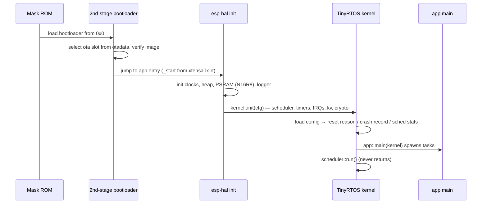

# Architecture

**Status:** draft v0.5 · 2026-09-21
Companion to [PLAN.md](PLAN.md). This document is the design the phases implement.

---

## 1. Layers and dependency rule

```
L5  apps/            sensor-node, actuator-node, gateway, examples
L4  services         provisioning · mqtt/discovery · ota · telemetry · time
L3  drivers          bus (i2c/spi/uart/1wire) · eeprom · mtd/flash · net/wifi · gpio/pwm/adc · sensors
L2  kernel (TinyRTOS) scheduler · interrupts · time · sync · event bus · driver core · kv · crypto · log · power
L1  hal / arch       traits + esp-hal glue + board pin maps (per chip)
L0  silicon          esp32s3 · esp32c6 · host (mock)
```

**Published boundary:** this tree is the SDK, published as `esp-sdk` (facade) plus implementation
crates. A consumer depends on the facade, enables a small curated feature set and supplies a
`board.dts`; libraries never read a project-global config. See [SDK.md](SDK.md).

**Rule:** dependencies only point down. `kernel/` depends on `hal/` traits, never on `drivers/`,
`subsys/` or `soc/`. `hal/` itself contains no chip-specific code; it defines traits and re-exports
the subset of `esp-hal` types that leak through (`Instant`, `Error`, GPIO handles). Only `soc/` and
`arch/` may `use esp_hal::…` directly. This is what lets the kernel compile for `x86_64` and what
makes the C6 port one new `soc/` crate. `cargo xtask check-deps` enforces the arrows.

```
hal/               traits only: Serial, I2cBus, SpiBus, GpioPin, Eeprom, Mtd, NetDevice, PowerMode
kernel/            scheduler · interrupts · time · sync · bus · driver core · kv · log · power
arch/{xtensa,riscv} CPU, IRQ entry, linker, context  (only place with unsafe + asm)
soc/{esp32s3,c6}   clocks, peripherals, flash, dma, wifi glue; implements the HAL traits
drivers/{bus,eeprom,mtd,net,gpio,sensor}   compatibles + probe, no board constants
subsys/{storage,net,ota,smarthome}         services over drivers + kernel
boards/<board>     board.dts + defconfig (data only)
config/            generated: sdkconfig.rs, board.rs, cfg flags
```

Generated config is the only place a feature switch is consumed: `Kconfig` + `board.dts` →
`esp-sdk-config` → every crate. See [CONFIGURATION.md](CONFIGURATION.md) for the pipeline and
[DRIVERS.md](DRIVERS.md) for the probe model. Allowed dependencies are enforced by `cargo xtask
check-deps`: `kernel/` may not depend on `soc/`, `drivers/` or `subsys/`; `drivers/` may not depend
on `subsys/`.

---

## 2. Boot sequence



Key points:

- **Bootloader and partition table stay ESP-IDF compatible** (see [§2.1](#21-bootloader-buy-or-build)).
- **`main` returns `!`** and hands control to the scheduler. There is no "super loop".
- **Crash record** is written before reset in the panic handler and read back on the next boot;
  three consecutive abnormal boots enter safe mode (no app tasks, provisioning AP only).

### 2.1 Bootloader: buy or build

| Stage | Who provides it | Replaceable | What it does |
|---|---|---|---|
| 1. Mask ROM | Espressif silicon | never | reads flash at 0x0, verifies header, hands over to stage 2; also the UART/USB download mode that unbricks the board |
| 2. Bootloader | ESP-IDF binary, ~21 KB, bundled in `espflash` at 0x0 | **yes** | flash + PSRAM/clock init, partition table, `otadata` slot selection, image checksum/SHA-256/signature check, rollback flag, jump to app |
| 3. App | us (`esp-hal` + TinyRTOS) | of course | everything the product does |

**v1 decision (ADR-009): buy stage 2, own everything that decides what runs.** Concretely:

- The prebuilt IDF bootloader stays: slot selection, image validation, rollback and the
  secure-boot/encryption hooks already exist and are field-proven. Reimplementing them is a month
  of work whose failure mode is a bricked node.
- We own the **app-side** boot contract: partition table, `otadata` writes, "image pending verify"
  / "valid" marking, crash record in RTC RAM, safe mode (`esp-sdk-boot`).
- **Rollback is not free even with the IDF bootloader**: it only works if the bootloader was built
  with `CONFIG_BOOTLOADER_APP_ROLLBACK_ENABLE=y`; the prebuilt images widely used with `espflash`
  do not have it (and `smart_home_idf` has it disabled too). Phase 0 verifies this; if disabled,
  `xtask bootloader` builds one once (IDF v5.5 is installed here) and flashes it at 0x0.
- **App images stay ESP-IDF format** (`esp_app_desc!`, segment layout, checksum/SHA-256). That
  constraint is what keeps "build our own bootloader later" cheap.

Buy vs build, at a glance:

| | Buy (IDF) | Build (Rust) |
|---|---|---|
| To first boot / production | 0 / 0 | ~1 week / 3–5 weeks |
| Size budget | 21 KB in a 32 KB slot | ~32 KB unless `PARTITION_TABLE_OFFSET` moves |
| Secure boot / encryption | inherited | lost unless reimplemented — realistically never |
| Boot time | ~30–50 ms | ~10–15 ms (matters only for coin-cell nodes) |
| Bad image | field-proven | boot loop → physical recovery via ROM download mode |
| Ownership / learning | low | high |

Recommendation: keep the IDF bootloader through v1.0 and revisit only if Phase 5 shows a concrete
cost. A "no 2nd stage" design (app at 0x0) is rejected — it gives up OTA and partitioning to save
one flash read. Phase 6 spike scope is in [PLAN.md](PLAN.md#5-phases).

---

## 3. Kernel — TinyRTOS

The kernel owns the **scheduler**, the interrupt model, time, synchronisation, storage, crypto
front-end, logging and power policy. It is `#![forbid(unsafe_code)]`; the only unsafe lives in
`esp-sdk-arch-*`.

### 3.1 Scheduler

The scheduler is real, and it is priority-based; it is **not** preemptive (ADR-002).

```
       ┌──────────── Scheduler ─────────────┐
       │ ready bitmask per class (u32)      │
       │ deadline heap (static, 32 timers)  │
       │ cpu accounting (CCOUNT / mcycle)   │
       │ idle policy → WFI / light sleep    │
       └──────────────┬─────────────────────┘
          ┌───────────┼───────────┬──────────────┐
       Ctrl        App          Net           Idle
     (8 KiB)     (8 KiB)      (8 KiB)      (shared stack)
       per-class executor stack, round-robin inside class
```

- **Task states:** `Ready`, `Running`, `Sleeping(until)`, `Waiting(event|channel|signal)`,
  `Suspended`, `Dead`. Transitions are woken by ISR, timer, channel or explicit `yield`.
- **Classes:** `Ctrl` (control loops, button), `App` (state machines, sensors), `Net` (MQTT, WiFi
  housekeeping), plus `Idle`. One executor per class → a busy low-priority task cannot delay a
  high-priority wake. Within a class: round-robin, FIFO ready bitmask, O(1) pick.
- **Tickless.** No periodic tick. The next deadline arms the timer comparator; no work means no
  wakeup. This is a precondition for light sleep.
- **Timers:** static heap of 32 `TimerEntry { deadline, task_id, generation }`; `sleep_until`,
  `sleep`, `spawn_periodic`. A period overrun (task not run before its next deadline) fires
  `Event::Fault(Overrun { task })` and is counted per task.
- **Status:** the core is implemented and host-tested in `kernel/src/sched.rs` (ready bitmask queues,
  timer heap, generation-based cancellation); executor integration is Phase 1.
- **Wake latency targets:** ISR → task ≤ 50 µs p99 at 240 MHz; timer wake jitter ≤ 100 µs;
  console command response ≤ 20 ms.
- **Tasks are async futures, so there are no per-task stacks.** The stack belongs to the executor
  of the class (8 KiB each); a task's locals live inside its future. Consequences we design around:
  - future sizes are checked at build time with `const _: () = assert!(size_of::<Fut>() <= 2048)`;
  - recursion is banned in kernel and drivers (review rule, plus the compiler catches unbounded
    generic recursion);
  - a task that needs a deep call chain gets a `#[ram]` static buffer, not a bigger stack.
- **Starvation guard:** class weights + aging (a `Net` task waiting > 100 ms while `App` is
  continuously ready gets promoted for one slice).
- **CPU accounting:** CCOUNT (Xtensa) / `mcycle` (RISC-V) sampled at 1 kHz by a high-priority
  timer; per-task run time, wake count, max wake latency, overruns. `sched` console command and a
  diagnostics entity expose them.
- **Hard real-time lane:** work with a deadline tighter than ~100 µs runs in the interrupt handler
  or on a dedicated core (S3 core 0 = radio/WiFi, core 1 = app, configurable), not as a task.
- **Preemption:** deferred. It is a Phase 6 spike with an acceptance test (a 1 kHz control loop
  that must never miss), because Xtensa register-window context switching in Rust is where projects
  die. If the product needs it, it becomes a compile-time scheduler mode, not a rewrite.

### 3.2 Interrupts

- Static vector table; each IRQ is claimed once at boot by a driver (`IrqHandler` registration).
  Priorities are a fixed map (radio, timer, GPIO, buses) — no runtime priority juggling.
- **ISR contract:** ≤ 10 µs, no logging, no allocation, no blocking, no flash writes. The only
  allowed syscalls are `Channel::try_send`, `Signal::signal`, `PubSub::publish`, atomics and
  `waker.wake()`.
- Deferred work pattern: ISR → channel → task. Every driver documents its ISR and its worst-case
  execution time.
- Critical sections are bounded to 20 µs, implemented per arch (interrupt masking on one core,
  spin-lock + masking across cores on S3).
- Latency is measured, not assumed: a GPIO toggle in the ISR plus a scope, or cycle counters, with
  the numbers recorded in `docs/latency.md` and checked in Phase 1 and Phase 5.

### 3.3 Time and timers

- `Instant` = 64-bit microseconds from SYSTIMER, monotonic over uptime; `embassy-time` driver
  installed on the same clock.
- Wall clock = monotonic + offset, offset from SNTP and persisted in RTC RAM.
- One deadline heap shared by `sleep`, periodic tasks and driver timeouts; no per-driver timers.
- RTC keeps time across light sleep; deep sleep restores the offset and detects drift.

### 3.4 Synchronisation

| Primitive | Use | ISR-safe |
|---|---|---|
| `Mutex<T>` | shared state, short critical sections | no (signal only) |
| `Channel<T, N>` | ISR → task, driver → service | yes (send) |
| `Signal` | one-shot wake (button, packet, DMA done) | yes |
| `PubSub<T, N>` | event fan-out to N subscribers | yes (publish) |
| `AtomicU32` + `Waker` | counters, flags | yes |

Priority inversion is a design rule, not a runtime feature: never hold a `Mutex` across a long
`.await`, and never await while holding one (clippy lint in the kernel crate). Blocking on a mutex
is not possible — `try_lock` or restructure.

### 3.5 Event bus

Typed topics, no strings at runtime:

```rust
pub enum Event {
    Wifi(WifiEvent), Mqtt(MqttEvent),
    Button { id: ButtonId, action: ButtonAction },
    Sensor { id: SensorId, reading: Reading },
    Dma(DmaEvent), OtaProgress { pct: u8 },
    ConfigChanged, Fault(FaultCode),
}
```

`BUS.publish(Event)` is non-blocking and drops the oldest message when a subscriber is slow, except
for `Fault` and `OtaProgress`, which use dedicated reliable channels. Telemetry storms must never
stall control.

### 3.6 DMA

`esp-hal` exposes the S3 GDMA engine for SPI, I2C, UART, ADC and I2S; the kernel does not reimplement
it, it makes it safe.

- **Ownership model:** buffers are `Buffer<N>` values moved into a transfer and returned on
  completion (`await` → `(Result<(), Error>, Buffer<N>)`). No aliasing, no `&mut` aliasing across
  cores, no hidden allocation. Same model for SPI, UART and ADC.
- **Buffer pools:** one static pool per peripheral class (`DMA_BUF_1K`, `DMA_BUF_4K`), sized at boot
  from the board manifest. A driver that runs out returns `Err(Busy)` — it never allocates.
- **Cache coherency:** on S3, DMA to/from PSRAM needs cache writeback/invalidate around the
  transfer. Default rule: **DMA buffers live in internal RAM**; PSRAM DMA only through the
  cache-safe API (`dma::psram::Buffer`), which does the maintenance on the correct core. Alignment:
  4 bytes minimum, 32-byte cache lines for PSRAM.
- **Use cases:** ADC continuous sampling (sensor noise), UART log bursts, SPI sensor bursts, I2S
  audio later, OTA flash writes later.
- **Failure path:** DMA error IRQ → abort channel, reset FIFO, emit `Event::Fault`, driver retries
  once then degrades.

### 3.7 KV store

- Dedicated `kv` partition (128 KiB), 4 KiB sectors, append-only log of
  `(key, seq, len, crc, value)` records with compaction at 75 %.
- API: `get<T: Deserialize>`, `set<T: Serialize>` (atomic commit), `delete`, `iter`; `postcard`
  encoding; 1 KiB per value.
- Namespaces: `net/`, `mqtt/`, `dev/`, `cal/`, `ota/`. Namespace wipe is the recovery path.
- Secrets are sealed with AES-GCM under a device key (see §3.8), not stored in plaintext. Flash
  encryption is still Phase 5+; until then the key lives in an NVS/eFuse-derived slot and the
  limitation is documented.

### 3.8 Crypto

`subsys/crypto` is a thin front-end with two backends:

| Trait | HW backend (S3: AES, SHA, HMAC, RSA/MPI, TRNG) | SW backend (RustCrypto) |
|---|---|---|
| `Sha256` | SHA accelerator, streaming | `sha2` |
| `Hmac` | HMAC peripheral | `hmac` |
| `Aead` (AES-256-GCM) | AES + GCM | `aes-gcm` |
| `Rng` | TRNG + DRBG reseed | `rand_core` ChaCha |
| `Verifier` (Ed25519 / P-256) | — (no Ed25519 accelerator on S3) | `ed25519-dalek` / `p256` |
| `KeyStore` | eFuse / NVS-derived keys | in-memory test keys |

- The HW backend is selected per feature; the SW backend exists for the host, for C6 gaps and as a
  fallback, and both must pass the same known-answer tests (NIST vectors) in CI.
- Consumers: OTA image SHA-256 + Ed25519 signature, KV sealing, device identity keypair, MQTT
  credentials, provisioning tokens. TLS is still out of scope for v1.
- **Constant time:** all secret comparisons go through `subtle`; secrets are wrapped in
  `Secret<[u8; N]>` whose `Debug`/`defmt` impl prints `***` so they cannot leak into logs.
- **Budget:** HW-only paths add ~6–10 KB; software Ed25519 adds ~25 KB — feature-gated per app, and
  the size report tracks each crypto feature separately.

### 3.9 Logging and diagnostics

- `defmt` as the wire format, levels per module, compile-time filtering plus a runtime override
  (`log level debug`) from the console.
- Sinks, in priority order: USB-Serial-JTAG (default), UART, 2 KiB RAM ring (always on, for crash
  dump), 64 KiB circular log partition (field forensics).
- Panic path: flush the ring, write crash record, reset; the next boot publishes the previous crash
  over MQTT (retained, rate-limited).
- Logs and telemetry are separate: logs are human/forensic, telemetry is typed `Event`s with
  counters. No string formatting in the telemetry path.
- ISR logging is deferred through a lock-free SPSC ring; an ISR never formats.

### 3.10 Power and sleep

Two profiles, chosen by the app, both using the same kernel hooks:

| Profile | Behaviour |
|---|---|
| `Mains` | WiFi modem sleep (DTIM-aware), light sleep when idle > 20 ms, wake on GPIO/UART/timer |
| `Battery` | sample and publish every N minutes, deep sleep in between, wake on timer or GPIO |

- Idle path: scheduler finds no ready task → arm next deadline → `WFI`; if idle exceeds the
  threshold → light sleep with the configured wake sources.
- Drivers implement `suspend()`/`resume()`; a bus left half-clocked is a bug the sleep soak test
  catches.
- State that must survive: crash record, boot counters, wall-clock offset, WiFi calibration data
  (RTC RAM / NVS). Everything else is rebuilt on wake.
- Measurements are part of the deliverable: current per state (active, modem sleep, light sleep,
  deep sleep), wake latency, energy per report, in `docs/power.md`, measured with a PPK2/INA219-class
  meter — numbers are recorded, never assumed.
- Deep sleep still performs the OTA slot check, so a bad image cannot trap a battery node in a
  sleep loop.

### 3.11 Supervisor

- RWDT fed by the `Ctrl` executor only, 10 s. A task that hogs the executor trips it.
- Heartbeat registry: each task declares a max period; the monitor flags a hung service and resets
  cleanly before the watchdog fires dirty.
- Panic handler: crash record → RTC RAM, log ring flush, reset.
- Safe mode after 3 abnormal boots: no app tasks, serial console + provisioning AP, diagnostics
  published if credentials still work.

---

## 4. Platform abstraction (L1)

```rust
pub trait Platform { fn init(cfg: PlatformConfig) -> Self; fn reset_reason(&self) -> ResetReason; }
pub trait Serial: embedded_io::Write + embedded_io::Read { fn set_baud(&mut self, b: u32); }
pub trait GpioPin { fn set(&mut self, high: bool); fn get(&self) -> bool; }
pub trait I2cBus { async fn write(&mut self, addr: u8, b: &[u8]) -> Result<()>;
                   async fn read(&mut self, addr: u8, buf: &mut [u8]) -> Result<()>; }
pub trait SpiBus { async fn transfer(&mut self, tx: &[u8], rx: &mut [u8]) -> Result<()>; }
pub trait Pwm { fn set_duty(&mut self, permille: u16); fn enable(&mut self, on: bool); }
pub trait Adc { async fn sample(&mut self) -> Result<u16>; }
pub trait DmaChannel { async fn transfer(&mut self, buf: Buffer) -> (Result<()>, Buffer); }
pub trait Eeprom { fn capacity(&self) -> u32; fn page_size(&self) -> usize;
                   async fn read(&mut self, off: u32, buf: &mut [u8]) -> Result<()>;
                   async fn write(&mut self, off: u32, data: &[u8]) -> Result<()>; }
pub trait Mtd { fn size(&self) -> u64; fn erase_size(&self) -> u32;
                fn read(&mut self, off: u64, buf: &mut [u8]) -> Result<()>;
                fn erase(&mut self, off: u64, len: u64) -> Result<()>;
                fn write(&mut self, off: u64, data: &[u8]) -> Result<()>; }
pub trait NetDevice { fn name(&self) -> &'static str; fn mtu(&self) -> usize;
                      async fn up(&mut self) -> Result<()>;
                      fn link(&self) -> LinkState; fn stats(&self) -> NetStats; }
pub trait Rng { fn fill(&mut self, buf: &mut [u8]); }
pub trait PowerMode { async fn light_sleep(&mut self, wake: WakeSources);
                      fn deep_sleep(&mut self, wake: WakeSources) -> !; }
```

Full contracts (page sizes, write-cycle timing, partition guards, netdev stats) are in
[DRIVERS.md](DRIVERS.md).

- Chip selection is a compile-time feature: `chip-esp32s3`, `chip-esp32c6`, `chip-host`.
- Pin maps live in `boards/*`, never in drivers; apps name resources (`board.relay[0]`), not GPIOs.
- The `host` arch implements every trait with mocks (deterministic clock, fake I2C table, fake DMA)
  so kernel/services/manifest tests run under `cargo test` in milliseconds.

**Portability checklist** (enforced by review): no `unsafe`, no `esp_hal` import, no chip-specific
constant, no `#[cfg(target_arch)]` outside `arch/` and `soc/`.

---

## 5. Networking

### 5.1 WiFi

```
Idle → Connecting → Connected → Degraded → Connecting
                  ↘ Failed(backoff)
```

- Credentials: KV → serial provisioning → SoftAP portal (Phase 3).
- Backoff 1, 2, 4, 8, 16, 30, 30… s with jitter, reset after 60 s of stable link.
- `Degraded` = link up, broker unreachable: keep sampling, queue up to 16 publishes (drop-oldest).
- Portal compatible with the bench harness: `POST /wifisave` with form fields `s` and `p`,
  `GET /` status page. Deliberate — existing tooling keeps working.

### 5.2 MQTT

`MqttClient` trait isolates the codec; default is a thin async state machine over
`embedded-io-async` TCP:

- MQTT 3.1.1, clean session, keepalive 60 s, LWT retained on `…/availability`.
- QoS 0 telemetry (drop-oldest), QoS 1 commands/states with a 4-entry inflight table.
- Bounded inbound queue; command dispatch is a match on topic suffix.
- Reconnect with backoff, single-flight; publishes fail fast while offline.
- TLS out of scope for v1 (RAM); the transport trait leaves room.

### 5.3 Home Assistant discovery

Generated from the node manifest, retained on
`homeassistant/<component>/<node_id>/<object_id>/config`, removed on factory reset. Payloads are
built in a fixed 512 B buffer per entity; no heap, no runtime JSON library.

---

## 6. Smarthome device model

A node is a **manifest** plus drivers; the framework derives topics, discovery, command routing and
state publishing:

```rust
pub const MANIFEST: NodeManifest = NodeManifest {
    id: "bme280-01", name: "Living room",
    entities: &[
        Entity::sensor(SensorKind::Temperature, "temperature", "Temperature"),
        Entity::sensor(SensorKind::Humidity,    "humidity",    "Humidity"),
        Entity::binary_sensor(BinaryKind::Door, "door",        "Balcony door"),
        Entity::switch("relay1", "Lamp"),
    ],
    telemetry_period_ms: 30_000,
};
```

Capabilities: `Sensor`, `BinarySensor`, `Switch`, `Light`, `Cover`, `Number`, `Diagnostic`.
Entity ids are stable forever — they are HA identity; renaming is a migration.

---

## 7. Memory and flash budget

**Flash (16 MB, dual OTA):**

| Region | Offset | Size | Purpose |
|---|---|---|---|
| bootloader | 0x0 | 32 KiB | ESP-IDF 2nd stage (rollback-enabled build from `xtask`) |
| partition table | 0x8000 | 4 KiB | custom `partitions.csv` |
| nvs | 0x9000 | 24 KiB | bootloader / phy / calibration data |
| otadata | 0xf000 | 8 KiB | active slot + rollback state |
| phy_init | 0x11000 | 4 KiB | RF calibration |
| ota_0 | 0x20000 | 4 MiB | app slot A |
| ota_1 | 0x420000 | 4 MiB | app slot B |
| kv | 0x820000 | 128 KiB | config store |
| log | 0x840000 | 64 KiB | circular forensic log |
| storage | 0x850000 | ~7.7 MiB | OTA staging, future FS |

**RAM (S3: 512 KiB SRAM, 8 MiB PSRAM):**

| Consumer | Target |
|---|---|
| kernel statics (scheduler, timers, queues) | ≤ 12 KiB |
| executor stacks (3 × 8 KiB) | 24 KiB |
| drivers + DMA pools | ≤ 16 KiB (EEPROM/MTD/NET state is static, measured) |
| crypto working buffers | ≤ 4 KiB |
| net buffers (smoltcp, esp-radio) | ≤ 64 KiB |
| app state | ≤ 16 KiB |
| headroom | ≥ 25 % of DRAM |

PSRAM holds TLS/large buffers and OTA staging only; DMA to PSRAM goes through the cache-safe API.

CI enforces a size budget (`cargo size` / `cargo bloat`); exceeding it fails the build with a diff
of the offending symbols. Target: ≤ 450 KiB binary for the sensor node without TLS.

**Codegen:** `panic = "abort"`, `opt-level = "s"`, LTO in release, overflow checks in dev,
`debug = 2` in release for usable backtraces.

---

## 8. Testing hooks built into the design

- **Host arch** (`chip-host`): deterministic clock, scripted I2C/GPIO/Flash/DMA mocks, in-memory
  KV — kernel/services/manifest tests run in milliseconds.
- **Scheduler tests:** deterministic single-threaded harness that pumps the executor and asserts run
  order, deadlines, overrun events and the starvation guard.
- **Interrupt latency test:** GPIO toggle at ISR entry/exit, measured on a scope; recorded per release.
- **Crypto KATs:** NIST vectors for SHA-256, HMAC, AES-GCM; RFC 8032 for Ed25519 — HW and SW backends
  must agree byte for byte.
- **DMA stress:** back-to-back transfers, error injection, PSRAM cache-safe path, abort/restart.
- **Self-test command** (`selftest`): bus scan, sensor ID, relay click, flash r/w/crc, EEPROM
  verify, crypto KAT, DMA loopback.
- **Config snapshots:** `.config` + `board.dts` → generated files compared byte-for-byte, so a
  codegen change is reviewed as a diff rather than discovered at runtime.
- **Binding test:** every `compatible` in a defconfig's board file must resolve to a driver at build
  time; an unbound node is a CI failure.
- **Fault injection** feature: bus errors, truncated flash writes, dropped MQTT packets — used by the
  Phase 5 soak.
- **Power measurement** harness: current trace per state, wake latency, energy per report.

---

## 9. CI and test gates

The pipeline is part of the architecture, not an afterthought: the kernel is host-testable by
construction, and every layer has a gate that runs without hardware except the last one.

| Gate | Runs | Blocks |
|---|---|---|
| fmt, clippy, rustdoc | every push | merge |
| host unit tests (scheduler, config codegen, contract fixtures) | every push | merge |
| MSRV 1.95 | every push | merge |
| S3 / C6 release build | when `soc/*` lands | merge |
| config matrix (`allyesconfig`, `allnoconfig`, strict binding) | Phase 2+ | merge |
| HIL (flash, provisioning, MQTT contract, OTA rollback, sleep current) | self-hosted runner | release |

Details, caching and local equivalents: [CI.md](CI.md).

## 10. Security posture (v1)

| Aspect | v1 | Later |
|---|---|---|
| Transport | plain MQTT/TCP on the LAN | TLS with PSK (rustls) |
| Secrets at rest | AES-GCM sealed in KV, key from eFuse/NVS | flash encryption + eFuse key |
| OTA | SHA-256 + Ed25519 signature, rollback | anti-rollback counters |
| Identity | per-device Ed25519 keypair | attestation |
| Debug | serial console unauthenticated (physical access = trust) | console lock after provisioning |
| Attack surface | MQTT client, provisioning portal (provisioning mode only) | — |

Documented explicitly so nobody assumes more than it delivers.
