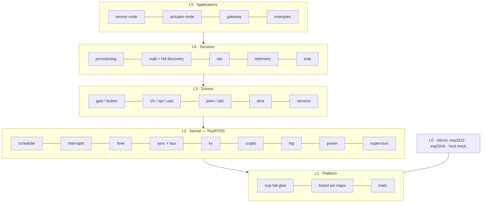

# esp_sdk_rustc — Build Plan

**Status:** draft v0.2 · 2026-09-21
**Goal:** a Rust SDK for ESP32 smart-home nodes that ships an OS — a tiny RTOS with the
scheduler, drivers, network and device framework — built from the application down, but
renting the CPU/PHY layer from `esp-hal`.

| | |
|---|---|
| Target silicon | **ESP32-S3** first (Xtensa LX7, 2 cores, 16 MB flash / 8 MB PSRAM), then ESP32-C6 (RISC-V) as the portability proof |
| Language | Rust, `no_std`, async-first |
| Product | MQTT smart-home node: sensors, actuators, Home Assistant discovery, OTA |
| Not this | Matter stack, cloud backend, voice, a new LLVM backend, a new WiFi PHY |

---

## 1. What "SDK with an OS" means here

An ESP32 project today can be one of three things:

1. **ESP-IDF app** — Espressif's OS (FreeRTOS) + drivers + WiFi. You own only `app/`.
2. **`esp-hal` + `embassy` app** — you own the app, HAL gives registers, embassy gives an executor.
3. **This SDK** — you own a *reusable OS layer*: scheduler, kernel services, driver model, crypto,
   logging, power management, device framework, provisioning, connectivity, OTA. An app is then
   ~200 lines of device description.

We are building **(3)**, on top of **(2)**. Writing a HAL from scratch is not the differentiator:
the WiFi/BT PHY on ESP32 is a closed binary blob with a fixed init sequence, and `esp-hal` already
solves Xtensa bring-up, clocks, PSRAM and the radio glue. The value we add is the layer an
application actually programs against — and that layer is what makes the same code portable from
S3 to C6 to classic ESP32.

### Guiding principles

- **Own the top, rent the bottom.** Kernel, drivers, crypto front-end, services and device model are
  ours. Registers and PHY are `esp-hal` / `esp-radio`.
- **Every phase ends on hardware.** A feature that has only ever been `cargo build`-ed is not done.
- **No allocator in the kernel.** Static task tables, bounded queues, fixed-capacity buffers.
  `alloc` is opt-in for app payloads and TLS.
- **The scheduler is the OS.** Priority classes, tickless timers, accounting and idle policy are
  kernel responsibilities — not something each app re-invents.
- **Async by default, interrupts where physics demands it.** No hand-written context switch in v1
  (see [ADR-002](#2-decision-log)).
- **Portability is a compile target, not a promise.** Every driver sits behind a trait; a second
  chip (C6) is built in CI from Phase 5, so the abstraction is tested by the compiler.
- **Fail safe and measure.** Watchdog, crash record, boot-loop counter, dual-slot OTA with rollback,
  safe mode — and latency/power numbers are recorded, not assumed.

---

## 2. Decision log

These are the decisions this plan is built on. They are **proposals** — confirm or flip them before
Phase 1 starts; changing one later is expensive.

| ID | Decision | Proposed choice | Alternative | Why |
|---|---|---|---|---|
| ADR-001 | HAL foundation | `esp-hal` 1.2.x + `esp-radio` + `embassy` | Own PAC-level HAL from scratch | Years of Xtensa/bootloader/PSRAM/radio-blob work for no product value |
| ADR-002 | Concurrency model | **Priority-class scheduler over async tasks** (cooperative); hard-real-time work in IRQ handlers or on a dedicated core | Preemptive priority kernel with asm context switch | Async futures have no per-task stacks, so preemption means writing Xtensa window-switching in Rust — the classic project killer. The scheduler still gives priorities, deadlines, accounting and tickless idle; revisit in a Phase 6 spike |
| ADR-003 | Runtime | `no_std` | `esp-idf-hal` (`std`, FreeRTOS underneath) | We cannot own the scheduler while FreeRTOS owns it |
| ADR-004 | Network stack | `embassy-net` (smoltcp) over `esp-radio` WiFi | Own lwIP/own TCP | smoltcp is proven in `no_std`, gives `embedded-io-async` streams for MQTT |
| ADR-005 | MQTT | `minimq` spike behind a thin `MqttClient` trait so we can swap to our own 3.1.1 codec | Adopt `rust-mqtt` wholesale | QoS1 + LWT + reconnect are the hard parts; a trait boundary keeps lock-in at the codec only |
| ADR-006 | Smarthome integration | MQTT + Home Assistant discovery | Native Matter on-device | Matter on ESP32-S3 is a multi-month detour; the Pi already bridges MQTT → Matter |
| ADR-007 | Portability proof | ESP32-C6 (RISC-V, upstream target) | Classic ESP32 (Xtensa LX6) | C6 builds without the esp toolchain fork and exposes API leaks fastest |
| ADR-008 | OS name | `tinytos` (workspace `esp-sdk`, crates `esp-sdk-*`) | — | Cosmetic; change now if you dislike it |
| ADR-009 | 2nd-stage bootloader | **Buy**: prebuilt ESP-IDF bootloader + our app-side boot/OTA/rollback logic | **Build**: Rust bootloader at 0x0 | Slot selection, validation, rollback and secure boot already exist; app images stay IDF-format so a Rust bootloader stays a drop-in option later. See [ARCHITECTURE §2.1](ARCHITECTURE.md#21-bootloader-buy-or-build) |
| ADR-010 | Crypto backend | RustCrypto SW *and* `esp-hal` HW accelerators behind one trait set; Ed25519 for OTA signatures | mbedTLS (ESP-IDF only), vendor TLS lib | mbedTLS pulls in `std`/IDF; RustCrypto is `no_std`, audited, and HW accel covers the hot paths (SHA/AES/HMAC) |
| ADR-011 | DMA ownership | Move-owned `Buffer<N>` + static pools; internal RAM default, cache-safe PSRAM API | Raw pointers + manual cache maintenance | Aliasing bugs and cache coherency are the two ways DMA breaks a product; the type system can prevent the first and encapsulate the second |
| ADR-012 | Sleep policy | Scheduler idle hook → WFI → light sleep; `Mains` and `Battery` profiles | Always-on (no sleep) | Sleep is a product requirement (battery nodes) and belongs in the kernel's idle path, not in each app |

---

## 3. Architecture at a glance



Dependency rule: **arrows only point down.** The kernel never calls a service; a driver never
calls MQTT. `esp-sdk-kernel` compiles for the host, which is what makes host-side unit tests possible.

The full design — scheduler, interrupts, DMA, crypto, logging, sleep, memory map, device model —
lives in [ARCHITECTURE.md](ARCHITECTURE.md).

### Subsystem inventory

| Capability | Crate | Phase | What "done" means |
|---|---|---|---|
| Scheduler (priority classes, tickless timers, accounting) | `esp-sdk-kernel` | 1 | run order, deadlines and overruns proven by deterministic host tests + 24 h on target |
| Interrupt model (static IRQ table, ISR→task, latency) | `esp-sdk-kernel` + arch | 1 | measured ISR entry/exit and wake latency in `docs/latency.md` |
| Logging (defmt, RAM ring, flash ring, crash dump) | `esp-sdk-kernel` | 1 | crash log survives reset and is readable over console + MQTT |
| Sync + event bus | `esp-sdk-kernel` | 1 | ISR-safe APIs documented and exercised |
| KV store (atomic, versioned, sealed) | `esp-sdk-kernel` | 2 | survives power loss at every write offset |
| DMA (move-owned buffers, pools, cache-safe PSRAM) | drivers + arch | 2 | SPI/UART/ADC transfers under load, abort/restart, no leaks |
| Crypto (SHA-256, HMAC, AES-GCM, TRNG, Ed25519) | `esp-sdk-crypto` | 2 | NIST/RFC KATs pass on HW and SW backends |
| Sensors + actuators | `esp-sdk-drivers` | 2 | BME280/BH1750 read, relay click, dimmer |
| WiFi + provisioning + MQTT + SNTP | `esp-sdk-net` / services | 3 | 72 h soak, AP flap, broker restart |
| HA discovery + device model | `esp-sdk-smarthome` | 4 | entities appear and control from HA |
| OTA (SHA-256 + Ed25519, dual slot, rollback) | services + boot | 4 | bad image rolls back, good image updates |
| Sleep (light, deep, modem) + power profiles | kernel + arch | 5 | measured current/wake latency, battery node runs 30 days |
| C6 port | `esp-sdk-arch-esp32c6` | 5 | same app source builds and runs |

---

## 4. Repository layout

```
esp_sdk_rustc/
├── Cargo.toml                  # workspace, pinned deps (esp-hal = "1.2")
├── rust-toolchain.toml         # channel = "esp" (Xtensa-enabled stable fork)
├── rustfmt.toml / clippy.toml
├── .cargo/config.toml          # target, runner = espflash, linker flags
├── partitions.csv              # bootloader, ota_0, ota_1, kv, log, storage
├── xtask/                      # build | flash | monitor | size | ota | bootloader | ci
├── crates/
│   ├── esp-sdk-kernel/         # scheduler, interrupts, time, sync, bus, kv, log, power, supervisor
│   ├── esp-sdk-hal/            # traits + re-exports; no chip-specific code
│   ├── esp-sdk-arch-esp32s3/   # impls for S3 (xtensa-esp32s3-none-elf)
│   ├── esp-sdk-arch-esp32c6/   # impls for C6 (riscv32imac-unknown-none-elf)
│   ├── esp-sdk-arch-host/      # mocks for `cargo test` on x86_64
│   ├── esp-sdk-boot/           # partition table, otadata, image verify, crash record
│   ├── esp-sdk-crypto/         # hash/hmac/aead/rng/signature, hw + sw backends
│   ├── esp-sdk-drivers/        # gpio, buses, pwm, adc, dma, sensors
│   ├── esp-sdk-net/            # wifi, dhcp, mqtt codec/client, sntp
│   ├── esp-sdk-services/       # provisioning, discovery, ota, telemetry, config
│   └── esp-sdk-smarthome/      # device model: capabilities → topics → discovery
├── boards/
│   ├── esp32s3-devkitc-1/      # N16R8 pin map, LED, button, psram config
│   └── esp32c6-devkitc/
├── apps/
│   ├── sensor-node/            # BME280 + BH1750 + reed switch
│   ├── actuator-node/          # 4 relays + 2 buttons + PWM dimmer
│   └── gateway/
├── tests/                      # host integration tests, HIL scripts
└── docs/                       # PLAN.md, ARCHITECTURE.md, ADRs, latency.md, power.md, board notes
```

Why a workspace and not one crate: compile-time feature isolation (`chip-esp32s3`), host-testable
pure logic, and an SDK users can depend on piecemeal. Everything is `#![no_std]` except `xtask`
and the host test harness.

---

## 5. Phases

Timeline assumes one developer at ~15–20 h/week. Each phase has a *demo* — the thing you show —
and *exit criteria* — the things that must be true to move on.

### Phase 0 — Ground truth and skeleton (1 week)

No product code. Establish what is actually true about the hardware and the toolchain.

- [ ] Install `espup` (v0.19.0) → `esp` toolchain (`xtensa-esp32s3-none-elf`), `espflash`,
      `cargo-bloat`, `llvm-tools`. Confirm builds for S3 and C6 targets.
- [ ] Confirm board revision and real flash/PSRAM (`espflash board-info`): N16R8 vs N8R2 matters —
      wrong PSRAM mode is a boot loop, not a build error.
- [ ] Flash a minimal `esp-hal` blink + `defmt` log; record boot time and binary size (this is the
      baseline every later phase is compared against).
- [ ] **Bootloader ground truth:** which `bootloader.bin` espflash writes at 0x0, was it built with
      `CONFIG_BOOTLOADER_APP_ROLLBACK_ENABLE`, does it honour `otadata`? If not, build one once,
      store it under `boards/`, flash it from `xtask`. OTA rollback is dead without it.
- [ ] Land workspace skeleton, `xtask`, CI (fmt, clippy, build S3, build C6, host tests), ADRs.
- [ ] Spike (1 day): can the local `esp32sim` emulator boot an `esp-hal` image? If yes it becomes a
      fast CI smoke test; if no, we do not depend on it.

**Demo:** `cargo xtask flash` puts a blinking, logging firmware on the board; CI is green.
**Exit:** toolchain reproducible from a clean machine; sizes recorded; simulator question answered.

### Phase 1 — TinyRTOS core: scheduler, interrupts, logging (3 weeks)

The phase that makes it an OS rather than a framework.

- [ ] **Scheduler:** 4 classes (`Ctrl/App/Net/Idle`), per-class executor with its own stack (8 KiB),
      round-robin inside a class, ready bitmask, `spawn`/`spawn_periodic`, `sleep_until`, `yield`,
      `suspend`/`resume`, starvation aging.
- [ ] **Timers:** static deadline heap (32 entries), tickless arm/disarm, period-overrun detection.
- [ ] **Accounting:** CCOUNT/`mcycle` sampling at 1 kHz, per-task run time, wake count, max latency,
      overruns; `sched` console command renders the table.
- [ ] **Interrupts:** static vector table + `IrqHandler` registration, fixed priority map, ISR
      contract, ISR→task wake path, bounded critical sections; latency test (GPIO toggle + scope)
      and `docs/latency.md`.
- [ ] **Sync + bus:** `Mutex`/`Channel`/`Signal`/`PubSub` wrappers with ISR contracts; typed event
      bus with drop-oldest for telemetry and reliable channels for `Fault`/`OtaProgress`.
- [ ] **Logging:** defmt over USB-Serial-JTAG and UART, runtime level filter, 2 KiB RAM ring,
      blocking flush on panic.
- [ ] **Boot/safety:** heap/stack placement, PSRAM init, watchdog (RWDT), panic handler → crash
      record in RTC RAM → reset, safe mode after 3 bad boots.
- [ ] **Console:** line editing, `help/status/tasks/sched/mem/log/reset/selftest`.
- [ ] Deterministic host tests: scheduler run order, deadlines, overruns, starvation guard, event
      bus drop policy.

**Demo:** three classes compete on real hardware — a 1 kHz control blink, a 100 ms sensor fake and
a chatty net task — for 24 h with zero overruns at `Ctrl`; `sched` shows CPU time per task; a forced
panic reboots and reports the crash record.
**Exit:** no busy-wait; no allocation; ISR→task latency measured and documented; scheduler
guarantees written down and tested.

### Phase 2 — Drivers, DMA, storage, crypto (3 weeks)

- [ ] Driver model: `Driver` trait (init / poll-or-async / shutdown / self-test), typed errors, no panics.
- [ ] GPIO + interrupt button with debounce; PWM (LEDC); ADC oneshot; I2C and SPI bus managers with
      timeouts and bus recovery.
- [ ] **DMA:** move-owned `Buffer<N>`, static pools per peripheral, async SPI/UART/ADC transfers,
      DMA error IRQ → abort/reset, cache-safe PSRAM path (writeback/invalidate), abort/restart tests.
- [ ] **KV store:** log-structured partition, atomic commit, CRC, compaction, namespaces.
- [ ] **Log partition:** 64 KiB circular defmt log, readable over console/MQTT, survives reset.
- [ ] **Crypto:** `Sha256`, `Hmac`, `AesGcm`, `Rng` (TRNG+DRBG), `Ed25519` verify; HW backend on S3
      (SHA/AES/HMAC/MPI/TRNG) and RustCrypto SW backend; NIST/RFC KATs in CI; `Secret<T>` redaction.
- [ ] First sensors: BME280, BH1750, reed contact; `selftest` covering bus scan, sensor ID, relay,
      flash r/w/crc, crypto KAT, DMA loopback.
- [ ] `boards/esp32s3-devkitc-1`: pin map + board manifest.

**Demo:** sensor node reads real values every 30 s, values and logs survive power cycle; DMA-driven
UART log burst at 1 Mbaud without dropping a byte; `selftest` green.
**Exit:** drivers never block the executor > 1 ms; bus error/timeout paths exercised by unplugging
devices; KV survives 1 000 power-loss injections; crypto KATs pass on HW and SW.

### Phase 3 — Connectivity (3 weeks)

The riskiest phase. Gate it with a spike before committing the design.

- [ ] Spike (3 days): `esp-radio` WiFi STA + `embassy-net` DHCP on S3; measure RAM, join time,
      reconnect after AP loss. Go/no-go for the async stack.
- [ ] WiFi manager: credentials from KV, exponential backoff, state machine
      (`Idle → Connecting → Connected → Degraded`), event bus notifications.
- [ ] Provisioning over serial console (always available) — SSID/password entry, validation, save.
- [ ] SoftAP captive portal fallback, compatible with the bench harness: `POST /wifisave` with form
      fields `s` and `p`, `GET /` status page.
- [ ] MQTT client behind `MqttClient`: CONNECT with LWT, keepalive, QoS0/QoS1, subscribe, reconnect
      with backoff, bounded outbound queue (drop-oldest telemetry), inflight table.
- [ ] SNTP time sync; wall clock persisted in RTC RAM.
- [ ] TLS decision spike (1 day): rustls memory cost with PSK, or stay plain on LAN.

**Demo:** node joins WiFi, reconnects after the AP is power-cycled, publishes to Mosquitto, survives
a broker restart without losing config.
**Exit:** 72 h soak with an AP flap every hour; RAM headroom ≥ 25 %.

### Phase 4 — Smarthome framework, discovery and OTA (3 weeks)

- [ ] Capability model: `Sensor`, `BinarySensor`, `Switch`, `Light`, `Cover`, `Number`, `Diagnostic`.
- [ ] Declarative manifest → topics, retained HA discovery payloads, availability (LWT), command
      routing, state debounce/rate-limit.
- [ ] Node state machine: `Boot → Provisioning → Connecting → Ready → Degraded → SafeMode`.
- [ ] **OTA:** HTTPS/HTTP pull from the Pi firmware server, stream to inactive slot, SHA-256 +
      Ed25519 verification, dual slot, `otadata` pending/valid marking, rollback on failed boot,
      progress over MQTT + serial.
- [ ] Diagnostics: RSSI, free heap/PSRAM, uptime, reset reason, scheduler overruns, MQTT stats,
      published as HA diagnostic entities.
- [ ] `apps/sensor-node` and `apps/actuator-node` reduced to manifest + wiring (~200 lines each).
- [ ] Deliberate-bad-image test: corrupted signature and corrupted image must both roll back.

**Demo:** from a clean board — provision over serial, node appears in Home Assistant with all
entities, relay toggles from HA, OTA updates the node and a broken image rolls back.
**Exit:** a new sensor type is added by one driver file + three manifest lines; rollback proven on
hardware with the rollback-enabled bootloader from Phase 0.

### Phase 5 — Power, portability and hardening (3 weeks)

- [ ] **Sleep:** idle hook → light sleep (wake: GPIO/UART/timer), WiFi modem sleep, deep sleep for
      the `Battery` profile (timer/GPIO wake, RTC retention), driver `suspend`/`resume`.
- [ ] **Power measurement:** current per state, wake latency, energy per report in `docs/power.md`;
      battery node target: ≥ 30 days on 2×AA at one report per 5 min (measured, then adjusted).
- [ ] `esp-sdk-arch-esp32c6` builds and runs the same drivers/services; fix every abstraction leak.
- [ ] Watchdog hardening: hung-task detection, boot-loop counter → safe mode, panic-in-ISR path.
- [ ] Fault injection: flash/kv corruption, sensor missing, broker down, DMA error, brown-out.
- [ ] 7-day soak with randomized faults; power-consumption regression check in CI where possible.
- [ ] Documentation: getting started, porting guide, API docs, board bring-up, `latency.md`,
      `power.md`.

**Demo:** same `sensor-node` source runs on S3 and C6; current measurements published; 7-day soak
passes; battery profile survives a month of simulated reports.
**Exit:** v1.0 — tagged, documented, reproducible from a clean machine.

### Phase 6 — Backlog (not scheduled)

- **Preemptive scheduler lane** (spike, 1 week): acceptance test is a 1 kHz control loop that must
  never miss; only if a real workload needs it. Adds per-task stacks and Xtensa window switching.
- **Rust 2nd-stage bootloader** (spike, 1 week): ROM → our bootloader → our app on S3, non-secure;
  partition table + `otadata` + SHA-256 + PSRAM init + ROM-download recovery demonstrated.
  Out of scope: secure boot, flash encryption, anti-rollback eFuses.
- BLE provisioning, Matter bridge on-device, ESP-NOW mesh, TLS with PSK, OTA delta, ULP sensor
  sampling, multi-node gateway.

---

## 6. Milestones

| Milestone | Content | Phase | Target |
|---|---|---|---|
| **M0** | Repo skeleton, toolchain, CI, blink + log | 0 | week 1 |
| **M1** | TinyRTOS: scheduler, interrupts, logging, watchdog, console | 1 | week 4 |
| **M2** | Drivers + DMA + KV + crypto KATs on hardware | 2 | week 7 |
| **M3** | WiFi + MQTT + provisioning, 72 h soak | 3 | week 10 |
| **M4** | HA discovery, actuator control, signed OTA with rollback | 4 | week 13 |
| **M5** | Sleep/power profiles, C6 port, 7-day soak → v1.0 | 5 | week 16 |

---

## 7. Verification strategy

| Layer | Method | Gate |
|---|---|---|
| Pure logic (codec, config, manifest, state machines) | `cargo test` on host with `arch-host` | every PR, coverage ≥ 80 % on these crates |
| Scheduler | deterministic host harness (run order, deadlines, overruns) + 24 h on target | Phase 1 exit, then nightly |
| Interrupts | scope-measured ISR entry/exit + ISR→task latency | Phase 1, re-checked in Phase 5 |
| Drivers | `selftest` + fault injection (unplug, timeout) | Phase 2 exit |
| DMA | stress + error injection + cache-safe PSRAM path | Phase 2 exit |
| Crypto | NIST/RFC KATs, HW vs SW cross-check | Phase 2 and every release |
| Network | host tests against Mosquitto (Docker); HIL soak | Phase 3 exit |
| Smarthome | discovery payload snapshots + real Home Assistant | Phase 4 exit |
| OTA | bad signature, corrupted image, power-cut mid-write, rollback | Phase 4 exit, each release |
| Sleep/power | current trace per state, wake latency, 30-day battery simulation | Phase 5 exit |
| Portability | CI build matrix S3 × C6, both flashed before release | every release |

Simulation: `esp32sim` (local, Xtensa S3, boots real firmware) is worth a Phase 0 spike for fast CI
feedback. It is never the *only* verification — real hardware remains the gate.

---

## 8. Risks

| # | Risk | Impact | Mitigation |
|---|---|---|---|
| R1 | Xtensa toolchain drift (esp fork) | Builds break on upgrade | Pin `esp` toolchain + `esp-hal`; CI caches toolchain; upgrades in a dedicated PR |
| R2 | `esp-hal` 1.2 → 2.0 API churn | Rework across arch crates | All HAL use confined to `esp-sdk-arch-*`; kernel/drivers depend on our traits only |
| R3 | WiFi stack unstable or too RAM-hungry on `no_std` | Blocks Phase 3 | 3-day spike with measured numbers before design freeze; fallback: `esp-idf-hal` only for the net crate |
| R4 | Xtensa has no upstream LLVM backend | Toolchain complexity for contributors | Document `espup` setup; devcontainer; C6 path uses upstream stable |
| R5 | TLS memory cost on S3 | OTA over HTTPS hard | Plain HTTP OTA on LAN first; rustls + PSK later; PSRAM buffers |
| R6 | Flash wear / config corruption | Bricked nodes | Dual slot + rollback, CRC + atomic commit, safe mode, serial recovery |
| R7 | Scope creep (Matter, voice, cloud) | Slips v1.0 | Non-goals are normative; backlog only |
| R8 | Async starvation from a blocking driver | Missed deadlines, watchdog resets | Driver rule: no blocking > 1 ms in executor context; overrun accounting catches violations |
| R9 | Prebuilt bootloader ignores `otadata` rollback | OTA has no safety net in the field | Phase 0 ground truth + `xtask bootloader` ships a rollback-enabled build; proven with a bad image |
| R10 | Custom bootloader attempt | Weeks lost, bricked boards | Deferred to a Phase 6 spike with explicit scope; app images stay IDF-compatible |
| R11 | "RTOS" expectation mismatch — someone expects preemptive scheduling | Wrong mental model, missed deadlines | Scheduler semantics documented and tested; hard-real-time lane via IRQ/dedicated core; preemption is a Phase 6 opt-in mode, decided by a concrete deadline requirement |
| R12 | DMA cache coherency on S3 (PSRAM) | Silent data corruption | Internal RAM for DMA by default; cache-safe PSRAM API; stress test + coherency checks |
| R13 | Crypto binary size and side channels | Flash budget blowout, weak secrets | Feature-gated backends, size report per feature, constant-time crates (`subtle`), no secret logging |
| R14 | Sleep/wake regressions (bus left half-clocked, drift) | Field failures, dead battery nodes | `suspend`/`resume` contract, sleep soak, power measurement in Phase 5, wake-latency budget |

---

## 9. Open questions

1. **Confirm ADR-001…012** (especially async-vs-preemptive, and buy-vs-build the bootloader).
2. **Hard real-time requirement:** what is the tightest deadline in your smarthome workload? If it is
   zero-cross dimming or motor control, the IRQ/dedicated-core lane must be designed now, and
   preemption moves earlier in the roadmap.
3. **Hardware on hand:** S3 DevKitC-1 N16R8? Which sensors/relays? A C6 board for Phase 5?
4. **Node types for the MVP:** sensor-only, actuator-only, or combined?
5. **Crypto scope for v1:** OTA signature + sealed config only, or device identity keys and TLS too?
6. **Power source:** mains-powered only, or battery nodes in the first release? Decides whether the
   `Battery` profile is Phase 5 or Phase 6.
7. **MQTT broker:** existing Mosquitto on the Pi / `Smart_Server`, or a fresh one?
8. **Name:** `tinytos` + `esp-sdk-*` crates acceptable, or rename before the tree exists?

Answering 1–4 unblocks Phase 0/1; the rest can wait.

---

## 10. Definition of done (v1.0)

- Clean-machine build: `git clone && cargo xtask setup && cargo xtask flash --board devkitc1 --app sensor-node`.
- Scheduler, interrupts, logging, KV, crypto, DMA and sleep are kernel/SDK features — an app does not
  reimplement any of them.
- A new board or chip is added by implementing `esp-sdk-arch-*` traits, without touching the kernel.
- A new device is added by writing a driver + manifest entry, without touching networking.
- Both S3 and C6 images build, flash and pass the smoke suite.
- Signed OTA rollback, safe mode, watchdog recovery and sleep/wake are demonstrated on hardware.
- `docs/latency.md` and `docs/power.md` contain measured numbers for the release.
- Docs: getting started, architecture, porting guide, ADRs, board notes.
