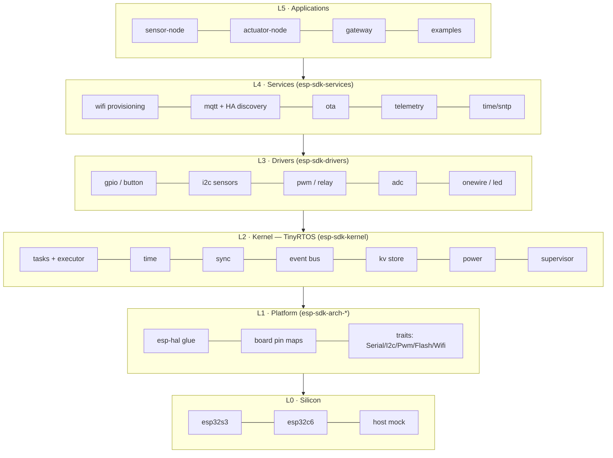

# esp_sdk_rustc — Build Plan

**Status:** draft v0.1 · 2026-09-21
**Goal:** a Rust SDK for ESP32 smart-home nodes that ships an OS — a tiny RTOS with the
scheduler, drivers, network and device framework — built from the application down, but
renting the CPU/PHY layer from `esp-hal`.

| | |
|---|---|
| Target silicon | **ESP32-S3** first (Xtensa LX7, 2 cores, 16 MB flash / 8 MB PSRAM), then ESP32-C6 (RISC-V) as the portability proof |
| Language | Rust, `no_std`, async-first |
| Product | MQTT smart-home node: sensors, actuators, Home Assistant discovery, OTA |
| Not this | Matter stack, cloud backend, voice, a new LLVM backend, a new WiFi PHY |

---

## 1. What "SDK with an OS" means here

An ESP32 project today can be one of three things:

1. **ESP-IDF app** — Espressif's OS (FreeRTOS) + drivers + WiFi. You own only `app/`.
2. **`esp-hal` + `embassy` app** — you own the app, HAL gives registers, embassy gives an executor.
3. **This SDK** — you own a *reusable OS layer*: kernel services, driver model, device framework,
   provisioning, connectivity, OTA. An app is then ~200 lines of device description.

We are building **(3)**, on top of **(2)**. Writing a HAL from scratch is not the differentiator:
the WiFi/BT PHY on ESP32 is a closed binary blob with a fixed init sequence, and `esp-hal` already
solves Xtensa bring-up, clocks, PSRAM and the radio glue. The value we add is the layer an
application actually programs against — and that layer is what makes the same code portable from
S3 to C6 to classic ESP32.

### Guiding principles

- **Own the top, rent the bottom.** Kernel, drivers, services and device model are ours. Registers
  and PHY are `esp-hal` / `esp-radio`.
- **Every phase ends on hardware.** A feature that has only ever been `cargo build`-ed is not done.
- **No allocator in the kernel.** Static task pools, bounded channels, fixed-capacity buffers.
  `alloc` is opt-in for app-level payloads and TLS.
- **Async by default, interrupts where physics demands it.** No hand-written context switch in v1
  (see [ADR-002](#adr-002)).
- **Portability is a compile target, not a promise.** Every driver sits behind a trait; a second
  chip (C6) is built in CI from Phase 5, so the abstraction is tested by the compiler.
- **Fail safe.** Watchdog, crash record, boot-loop counter, dual-slot OTA with rollback, safe mode.

---

## 2. Decision log

These are the decisions this plan is built on. They are **proposals** — confirm or flip them before
Phase 1 starts; changing one later is expensive.

| ID | Decision | Proposed choice | Alternative | Why |
|---|---|---|---|---|
| ADR-001 | HAL foundation | `esp-hal` 1.2.x + `esp-radio` + `embassy` | Own PAC-level HAL from scratch | Years of Xtensa/bootloader/PSRAM/radio-blob work for no product value |
| ADR-002 | Concurrency model | Cooperative async tasks + interrupt priorities | Preemptive round-robin / priority kernel with asm context switch | Xtensa context switching in Rust is fragile; `embassy` covers ~95% of smarthome work; revisit only if a hard-deadline workload appears |
| ADR-003 | Runtime | `no_std` | `esp-idf-hal` (`std`, FreeRTOS underneath) | We cannot own the scheduler while FreeRTOS owns it |
| ADR-004 | Network stack | `embassy-net` (smoltcp) over `esp-radio` WiFi | Own lwIP/own TCP | smoltcp is proven in `no_std`, gives us `embedded-io-async` streams for MQTT |
| ADR-005 | MQTT | Start with `minimq` spike, keep a thin `MqttClient` trait so we can swap to our own 3.1.1 codec | Adopt `rust-mqtt` wholesale | QoS1 + LWT + reconnect are the hard parts; a trait boundary keeps vendor lock-in at the codec only |
| ADR-006 | Smarthome integration | MQTT + Home Assistant discovery (as `smart_home_idf`) | Native Matter on-device | Matter on ESP32-S3 is a multi-month detour; the Pi already bridges MQTT → Matter |
| ADR-007 | Portability proof | ESP32-C6 (RISC-V, upstream target) | Classic ESP32 (Xtensa LX6) | C6 builds without the esp toolchain fork and exposes API leaks fastest |
| ADR-008 | OS name | `tinytos` (workspace `esp-sdk`, crates `esp-sdk-*`) | — | Cosmetic; change now if you dislike it |

---

## 3. Architecture at a glance



Dependency rule: **arrows only point down.** The kernel never calls a service; a driver never
calls MQTT. `esp-sdk-kernel` compiles for the host, which is what makes host-side unit tests possible.

The full design — boot flow, task model, memory map, flash layout, driver traits, device manifest —
lives in [ARCHITECTURE.md](ARCHITECTURE.md).

---

## 4. Repository layout

```
esp_sdk_rustc/
├── Cargo.toml                  # workspace, pinned deps (esp-hal = "1.2")
├── rust-toolchain.toml         # channel = "esp" (Xtensa-enabled stable fork)
├── rustfmt.toml / clippy.toml
├── .cargo/config.toml          # target, runner = espflash, linker flags
├── partitions.csv              # bootloader, ota_0, ota_1, kv, storage
├── xtask/                      # build | flash | monitor | size | ota | ci
├── crates/
│   ├── esp-sdk-kernel/         # TinyRTOS: tasks, time, sync, bus, store, power, supervisor
│   ├── esp-sdk-hal/            # traits + re-exports; no chip-specific code
│   ├── esp-sdk-arch-esp32s3/   # impls for S3 (xtensa-esp32s3-none-elf)
│   ├── esp-sdk-arch-esp32c6/   # impls for C6 (riscv32imac-unknown-none-elf)
│   ├── esp-sdk-arch-host/      # mock impls for `cargo test` on x86_64
│   ├── esp-sdk-drivers/        # gpio, i2c, pwm, adc, onewire, button, sensors
│   ├── esp-sdk-net/            # wifi, dhcp, mqtt codec/client, sntp
│   ├── esp-sdk-services/       # provisioning, discovery, ota, telemetry, config
│   └── esp-sdk-smarthome/      # device model: capabilities → topics → discovery
├── boards/
│   ├── esp32s3-devkitc-1/      # N16R8 pin map, LED, button, psram config
│   └── esp32c6-devkitc/
├── apps/
│   ├── sensor-node/            # BME280 + BH1750 + reed switch
│   ├── actuator-node/          # 4 relays + 2 buttons + PWM dimmer
│   └── gateway/                # optional: MQTT ↔ infra
├── tests/                      # host integration tests, HIL scripts
└── docs/                       # PLAN.md, ARCHITECTURE.md, ADRs, board notes
```

Why a workspace and not one crate: compile-time feature isolation (`chip-esp32s3`), host-testable
pure logic, and an SDK users can depend on piecemeal. Everything is `#![no_std]` except `xtask`
and the host test harness.

---

## 5. Phases

Timeline assumes one developer at ~15–20 h/week. Each phase has a *demo* — the thing you show —
and *exit criteria* — the things that must be true to move on.

### Phase 0 — Ground truth and skeleton (1 week)

No product code. Establish what is actually true about the hardware and the toolchain, because a
wrong assumption here costs a week later.

- [ ] Install `espup` (v0.19.0 available) → `esp` toolchain (`xtensa-esp32s3-none-elf`), `espflash`,
      `cargo-bloat`, `llvm-tools`. Confirm `cargo build` for S3 and C6 targets.
- [ ] Confirm board revision and real flash/PSRAM (`espflash board-info`): N16R8 vs N8R2 matters —
      wrong PSRAM mode is a boot loop, not a build error.
- [ ] Flash a minimal `esp-hal` blink + `defmt` log; record boot time and binary size as the baseline.
- [ ] Land workspace skeleton, `xtask`, CI (fmt, clippy, build S3, build C6, host tests), ADRs.
- [ ] Spike (timeboxed, 1 day): can the local `esp32sim` emulator boot an `esp-hal` image? If yes,
      it becomes a fast CI smoke test; if no, we do not depend on it.

**Demo:** `cargo xtask flash` puts a blinking, logging firmware on the board; CI is green.
**Exit:** toolchain reproducible from a clean machine; sizes recorded; simulator question answered.

### Phase 1 — TinyRTOS kernel v0 (2 weeks)

- [ ] Boot path: linker script, `_start`, heap/stack placement, PSRAM init on N16R8.
- [ ] Kernel init: clock tree, timer, defmt logger over USB-Serial-JTAG *and* UART.
- [ ] Time: monotonic `Instant`/`Duration` on SYSTIMER, `embassy-time` driver, tickless idle hook.
- [ ] Tasks: static task pool, `spawn`, priorities via executor selection, stack watermark reporting.
- [ ] Sync: `Mutex`, `Channel`, `Signal`, `PubSub` wrappers with documented ISR-safety rules.
- [ ] Event bus: typed topics, bounded fan-out, publish from ISR safe path.
- [ ] Supervisor: RWDT feed, task heartbeat registry, panic handler → crash record in RTC RAM → reset.
- [ ] Serial console: line editing, `help/status/tasks/mem/log` commands.
- [ ] Host-testable parts (`esp-sdk-kernel` with `arch-host`) covered by unit tests.

**Demo:** three concurrent tasks (blink, fake sensor, console) run for 24 h; `tasks` shows stack
usage; `kill -9`-equivalent (panic) reboots and reports the crash record.
**Exit:** zero-allocation task creation; no busy-wait in kernel; kernel object sizes documented.

### Phase 2 — Drivers and persistent config (2 weeks)

- [ ] Driver model: `Driver` trait (init / poll-or-async / shutdown / self-test), error type, no panics.
- [ ] GPIO + interrupt-driven button with debounce; PWM (LEDC) for dimmer/relay pulse; ADC oneshot.
- [ ] I2C bus manager: shared bus, device handles, timeouts, bus recovery (clock stretching).
- [ ] First sensors: BME280 (temp/hum/press) and BH1750 (lux), plus a reed/contact input.
- [ ] KV store on a dedicated flash partition: versioned config, atomic commit, CRC, wear-friendly.
- [ ] Config schema: network, mqtt, device identity, calibration — serialized compactly (postcard).
- [ ] `boards/esp32s3-devkitc-1`: pin map + board manifest.

**Demo:** sensor node reads real values every 30 s and prints them; config survives power cycle and
reflash of the app slot.
**Exit:** drivers never block the executor > 1 ms; I2C timeout/recovery proven by unplugging a sensor.

### Phase 3 — Connectivity (3 weeks)

The riskiest phase. Gate it with a spike before committing the design.

- [ ] Spike (3 days): `esp-radio` WiFi STA on S3 + `embassy-net` DHCP; measure RAM, join time,
      reconnect behaviour after AP loss. Go/no-go for the async stack.
- [ ] WiFi manager: credentials from KV, exponential backoff, state machine
      (`Idle → Connecting → Connected → Degraded`), event bus notifications.
- [ ] Provisioning over serial console (always available) — SSID/password entry, validation, save.
- [ ] SoftAP captive portal fallback, compatible with the testbench harness:
      `POST /wifisave` with form fields `s` and `p`, plus `GET /` status page.
- [ ] MQTT client behind `MqttClient` trait: CONNECT with LWT, keepalive, QoS0/QoS1 publish,
      subscribe, reconnect with backoff, bounded outbound queue, drop-oldest telemetry policy.
- [ ] SNTP time sync; wall clock persisted across reboots (offset in RTC RAM).
- [ ] MQTT over plain TCP on the LAN first; TLS is a later, separate decision (memory cost).

**Demo:** node joins WiFi, reconnects after the AP is power-cycled, publishes to Mosquitto, and
survives a broker restart without losing its config.
**Exit:** 72 h soak with an AP flap every hour; RAM headroom ≥ 25 %.

### Phase 4 — Smarthome framework, discovery and OTA (3 weeks)

- [ ] Capability model: `Sensor`, `BinarySensor`, `Switch`, `Light`, `Cover`, `Number`, `Diagnostic`.
- [ ] Declarative node manifest (`const` table) → topics, HA discovery payloads, availability (LWT),
      command routing, state debounce/rate-limit.
- [ ] Home Assistant discovery: retained `homeassistant/<component>/<node>/<object>/config`,
      device classes, units, `state_class`, origin/device blocks.
- [ ] Node state machine: `Boot → Provisioning → Connecting → Ready → Degraded → SafeMode`.
- [ ] OTA: HTTPS (or HTTP on LAN) pull from the Pi firmware server, dual slot, SHA-256 check,
      rollback on failed boot, OTA progress over MQTT + serial.
- [ ] Diagnostics: RSSI, free heap/PSRAM, uptime, reset reason, task watermarks, MQTT stats,
      published as HA diagnostic entities.
- [ ] `apps/sensor-node` and `apps/actuator-node` reduced to manifest + wiring (~200 lines each).

**Demo:** from a clean board — provision over serial, node appears in Home Assistant with all
entities, relay toggles from HA, OTA updates the node and a deliberately broken image rolls back.
**Exit:** a new sensor type can be added by writing one driver file and three manifest lines.

### Phase 5 — Portability, power and hardening (3 weeks)

- [ ] `esp-sdk-arch-esp32c6` builds in CI from the same drivers/services; fix every abstraction leak.
- [ ] Power: light sleep when idle, WiFi modem sleep, wake on GPIO/timer, measured current per mode;
      battery-node profile (report every 5 min, deep sleep between reports) if hardware allows.
- [ ] Watchdog hardening: task hang detection, boot-loop counter → safe mode with recovery AP.
- [ ] Flash/kv corruption injection, brown-out behaviour, panic-in-ISR path.
- [ ] 7-day soak with randomized faults (broker down, AP down, sensor missing, flash full).
- [ ] Documentation: getting started, porting guide, API docs, board bring-up guide.

**Demo:** the same `apps/sensor-node` runs on S3 and C6 from one source tree; current measurements
published; 7-day soak passes.
**Exit:** v1.0 — tagged, documented, reproducible build from a clean machine.

### Phase 6 — Backlog (not scheduled)

BLE provisioning, Matter bridge on-device, ESP-NOW mesh, TLS with PSK, OTA delta, ULP sensor
sampling, multi-node gateway.

---

## 6. Milestones

| Milestone | Content | Phase | Target |
|---|---|---|---|
| **M0** | Repo skeleton, toolchain, CI, blink + log | 0 | week 1 |
| **M1** | Kernel v0: tasks, time, sync, console, watchdog | 1 | week 3 |
| **M2** | Sensor node on real hardware, config persisted | 2 | week 5 |
| **M3** | WiFi + MQTT + provisioning, 72 h soak | 3 | week 8 |
| **M4** | HA discovery, actuator control, OTA with rollback | 4 | week 11 |
| **M5** | C6 port, power management, 7-day soak | 5 | week 14 |

---

## 7. Verification strategy

| Layer | Method | Gate |
|---|---|---|
| Pure logic (codec, config, state machines, manifest) | `cargo test` on host, `arch-host` mocks | every PR, coverage ≥ 80 % on these crates |
| Kernel | host unit tests + on-target stress test | Phase 1 exit, then nightly soak |
| Drivers | on-target self-test command + fault injection (unplug) | Phase 2 exit |
| Network | host tests against Mosquitto in Docker; HIL soak | Phase 3 exit |
| Smarthome | discovery payload snapshots + real Home Assistant | Phase 4 exit |
| Portability | CI build matrix S3 × C6, both flashed before release | every release |
| OTA | deliberate bad image, power-cut mid-write, rollback | Phase 4 exit, each release |

Simulation: `esp32sim` (local, Xtensa S3, boots real firmware) is worth a Phase 0 spike for fast CI
feedback. It is never the *only* verification — real hardware remains the gate.

---

## 8. Risks

| # | Risk | Impact | Mitigation |
|---|---|---|---|
| R1 | Xtensa toolchain drift (esp fork, nightly-ish) | Builds break on upgrade | Pin `esp` toolchain + `esp-hal` in `rust-toolchain.toml` / `Cargo.lock`; CI caches toolchain; upgrade in a dedicated PR |
| R2 | `esp-hal` 1.2 → 2.0 API churn | Rework across arch crates | All HAL use confined to `esp-sdk-arch-*`; kernel/drivers depend on our traits only |
| R3 | WiFi stack unstable or too RAM-hungry on `no_std` | Blocks Phase 3 | 3-day spike with measured numbers before design freeze; fallback: `esp-idf-hal` only for the net crate, or stay LAN-serial |
| R4 | Xtensa has no upstream LLVM backend | Toolchain complexity for contributors | Document `espup` setup; provide container/devcontainer; C6 path uses upstream stable |
| R5 | TLS memory cost on S3 (mbedTLS vs rustls) | OTA over HTTPS hard | Plain HTTP OTA on LAN first; rustls + PSK later; PSRAM buffers |
| R6 | Flash wear / config corruption | Bricked nodes | Dual-slot + rollback, CRC + atomic commit, safe mode, serial recovery |
| R7 | Scope creep (Matter, voice, cloud) | Slips v1.0 | Non-goals list is normative; backlog only |
| R8 | Async starvation from a blocking driver | Missed deadlines, watchdog resets | Driver rule: no blocking > 1 ms in executor context; watchdog catches violations |

---

## 9. Open questions

1. **Confirm ADR-001…008** (especially async vs preemptive — this changes the kernel design).
2. **Hardware on hand:** S3 DevKitC-1 N16R8? Which sensors/relays? A C6 board for Phase 5?
3. **Node types for the MVP:** sensor-only, actuator-only, or combined? Drives the first app.
4. **MQTT broker:** existing Mosquitto on the Pi / `Smart_Server`, or a fresh one?
5. **Provisioning:** serial-only acceptable for v1, or is SoftAP portal required from day one?
6. **Name:** `tinytos` + `esp-sdk-*` crates acceptable, or rename before the tree exists?

Answering 1–3 unblocks Phase 0/1; 4–6 can wait a week.

---

## 10. Definition of done (v1.0)

- Clean-machine build: `git clone && cargo xtask setup && cargo xtask flash --board devkitc1 --app sensor-node` works.
- A new board or chip is added by implementing `esp-sdk-arch-*` traits, without touching the kernel.
- A new device is added by writing a driver + manifest entry, without touching networking.
- Both S3 and C6 images build, flash and pass the smoke suite.
- OTA rollback, safe mode and watchdog recovery demonstrated on hardware.
- Docs: getting started, architecture, porting guide, ADRs, board notes.
