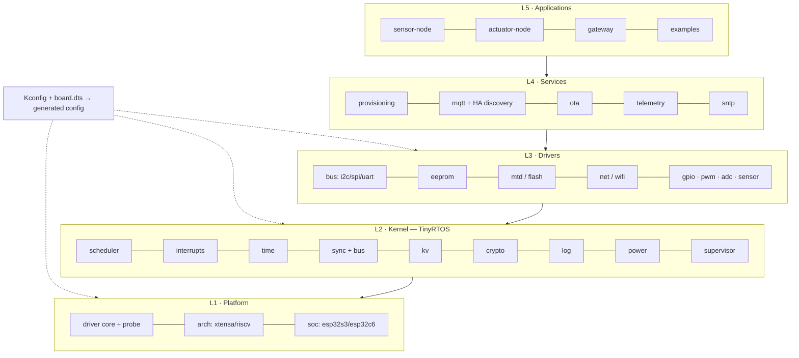

# esp_sdk_rustc — Build Plan

**Status:** draft v0.14 · 2026-11-22
**Goal:** a Rust **SDK** for ESP32 smart-home nodes that ships an OS — a tiny RTOS with the scheduler,
drivers, network and device framework — portable across chips and boards the way a Linux kernel is:
configuration-driven, hardware described in data, drivers bound by compatible string. Customers
depend on it to build their own products; `apps/` here are examples.

| | |
|---|---|
| Target silicon | **ESP32-S3** first (Xtensa LX7, 2 cores, 16 MB flash / 8 MB PSRAM), then ESP32-C6 (RISC-V) as the portability proof |
| Language | Rust, `no_std`, async-first |
| Product | **SDK** (published crates + examples); first consumer: `smart_home_idf` migration |
| Not this | Matter stack, cloud backend, voice, a new LLVM backend, a new WiFi PHY |

---

## 1. What "SDK with an OS" means here

An ESP32 project today can be one of three things:

1. **ESP-IDF app** — Espressif's OS (FreeRTOS) + drivers + WiFi. You own only `app/`.
2. **`esp-hal` + `embassy` app** — you own the app, HAL gives registers, embassy gives an executor.
3. **This SDK** — you own a *reusable OS layer*: scheduler, kernel services, driver model, crypto,
   logging, power management, device framework, provisioning, connectivity, OTA — plus the
   configuration system that makes one tree serve many boards.

We are building **(3)**, on top of **(2)**. Writing a HAL from scratch is not the differentiator:
the WiFi/BT PHY on ESP32 is a closed binary blob with a fixed init sequence, and `esp-hal` already
solves Xtensa bring-up, clocks, PSRAM and the radio glue. The value we add is the layer an
application programs against — and the portability model that lets the same kernel run on S3, on C6,
and on a board nobody has designed yet.

### Guiding principles

- **Own the top, rent the bottom.** Kernel, drivers, crypto front-end, services and device model are
  ours. Registers and PHY are `esp-hal` / `esp-radio`.
- **Configuration, not forks.** One tree; Kconfig selects features, the board `.dts` describes
  hardware, defconfigs define products. No `#ifdef` forks, no per-board copies of drivers.
- **Hardware is data.** Pins, addresses, bus speeds and partitions live in the board file. A new
  board is a `.dts` + defconfig, not Rust.
- **Drivers bind by compatible string**, Linux-style: a driver declares `atmel,at24c256`, the board
  node says `compatible = "atmel,at24c256"`, the probe loop connects them at build time.
- **Disabled code is gone.** Kconfig out = no flash cost; `allyesconfig` in CI keeps it from rotting.
- **Every phase ends on hardware.** A feature that has only ever been `cargo build`-ed is not done.
- **No allocator in the kernel.** Static task tables, bounded queues, fixed-capacity buffers.
- **The scheduler is the OS.** Priority classes, tickless timers, accounting and idle policy are
  kernel responsibilities, not something each app re-invents.
- **Async by default, interrupts where physics demands it.** No hand-written context switch in v1
  (ADR-002).
- **Portability is a compile target, not a promise.** Every driver sits behind a trait; a second
  chip (C6) is built in CI from Phase 2, so the abstraction is tested by the compiler.
- **Fail safe and measure.** Watchdog, crash record, boot-loop counter, signed dual-slot OTA with
  rollback, safe mode — and latency/power numbers are recorded, not assumed.

---

## 2. Decision log

These are the decisions this plan is built on. The ones in §2.1 are **locked by the owner**; the rest
are provisional defaults that can still be flipped cheaply.

| ID | Decision | Proposed choice | Alternative | Why |
|---|---|---|---|---|
| ADR-001 | HAL foundation | `esp-hal` 1.2.x + `esp-radio` + `embassy` | Own PAC-level HAL from scratch | Years of Xtensa/bootloader/PSRAM/radio-blob work for no product value |
| ADR-002 | Concurrency model | **Priority-class scheduler over async tasks** (cooperative); hard-real-time work in IRQ handlers or on a dedicated core | Preemptive priority kernel with asm context switch | Async futures have no per-task stacks, so preemption means writing Xtensa window-switching in Rust. The scheduler still gives priorities, deadlines, accounting and tickless idle; revisit in a Phase 9 spike |
| ADR-003 | Runtime | `no_std` | `esp-idf-hal` (`std`, FreeRTOS underneath) | We cannot own the scheduler while FreeRTOS owns it |
| ADR-004 | Network stack | `embassy-net` (smoltcp) over a `NetDevice` trait | Own lwIP/own TCP | smoltcp is proven in `no_std`, gives `embedded-io-async` streams; the trait keeps Ethernet/WiFi swappable |
| ADR-005 | MQTT | `minimq` spike behind a thin `MqttClient` trait so we can swap to our own 3.1.1 codec | Adopt `rust-mqtt` wholesale | QoS1 + LWT + reconnect are the hard parts; a trait boundary keeps lock-in at the codec only |
| ADR-006 | Smarthome integration | MQTT + Home Assistant discovery | Native Matter on-device | Matter on ESP32-S3 is a multi-month detour; the Pi already bridges MQTT → Matter |
| ADR-007 | Portability proof | ESP32-C6 (RISC-V, upstream target) | Classic ESP32 (Xtensa LX6) | C6 builds without the esp toolchain fork and exposes API leaks fastest |
| ADR-008 | OS name | `tinytos` (workspace `esp-sdk`) | — | Cosmetic; change now if you dislike it |
| ADR-009 | 2nd-stage bootloader | **Buy**: prebuilt ESP-IDF bootloader + our app-side boot/OTA/rollback logic | **Build**: Rust bootloader at 0x0 | Slot selection, validation, rollback and secure boot already exist; app images stay IDF-format so a Rust bootloader stays a drop-in option later. See [ARCHITECTURE §2.1](ARCHITECTURE.md#21-bootloader-buy-or-build) |
| ADR-010 | Crypto backend | RustCrypto SW *and* `esp-hal` HW accelerators behind one trait set; Ed25519 for OTA signatures | mbedTLS (ESP-IDF only), vendor TLS lib | mbedTLS pulls in `std`/IDF; RustCrypto is `no_std`, audited, and HW covers the hot paths |
| ADR-011 | DMA ownership | Move-owned `Buffer<N>` + static pools; internal RAM default, cache-safe PSRAM API | Raw pointers + manual cache maintenance | Aliasing and cache coherency are how DMA breaks products; the type system prevents the first and encapsulates the second |
| ADR-012 | Sleep policy | Scheduler idle hook → WFI → light sleep; `Mains` and `Battery` profiles | Always-on (no sleep) | Sleep is a product requirement and belongs in the kernel idle path, not each app |
| ADR-013 | Configuration system | **Kconfig** (vendored kconfiglib, ISC) → generated `sdkconfig.rs` + cfg flags; Cargo features stay internal | Cargo feature matrix per product | Features cannot express defaults, ranges, dependencies or help; Kconfig can, and it is the model the user asked for |
| ADR-014 | Hardware description | **DTS** (`cpp` + `dtc` 1.7) parsed at build time into a `BoardIR`, code-generated board tables; TOML front-end possible later | TOML/RON board manifest | DTS is the Linux model: includes, overlays, tooling, compatible strings. `dtc` is already installed |
| ADR-015 | Driver binding | Static registry + `compatible` matching + probe/deferred-probe, no modules, no hotplug | Runtime driver loading | Same as Linux minus the parts we cannot use on a 512 KiB MCU; build-time binding keeps size and failure modes small |
| ADR-016 | Storage stack | MTD core + range-checked partitions + **KV + log + OTA**, no general filesystem in v1 | littlefs from day one | KV/log/OTA cover the product; a filesystem adds C bindgen and wear/format risk. `embedded-storage` adapter keeps it open |
| ADR-017 | SDK distribution boundary | Published crates expose a **small Cargo feature contract**; Kconfig is the authoring/CI front-end that produces feature sets; `esp-sdk-build` compiles the customer's `board.dts` | Ship a global `.config` consumed by libraries | A crates.io consumer must build from `Cargo.lock` + features alone; libraries cannot read a project-global config. Features stay curated so the matrix does not explode |
| ADR-018 | Migration strategy | **Freeze the external contract, shadow-run, then cut over per node**; keep the IDF image as rollback | Big-bang rewrite | Documentation and code disagree in the C++ repo; the broker contract is positional, so it must be captured from code and diffed, not assumed. See [MIGRATION.md](MIGRATION.md) |
| ADR-019 | Versioning | Lockstep `0.x` across crates, one tag, `cargo semver-checks` on the facade, MSRV 1.95 | Independent crate versions | One version is the only thing a customer can reason about before 1.0; independent versions triple the release matrix for no benefit |
| ADR-020 | Bootloader ownership | **Buy for v1** (ADR-009) + a gated **staged spike B0–B5** to own stage 2; the cheaper boot-manager-app option first if the need is a boot menu/recovery | Rewrite stage 2 immediately | Ownership buys boot menus, signature policy and branding, but the MMU/cache mapping, secure boot and flash encryption are weeks of UART-only debugging. [BOOTLOADER.md](BOOTLOADER.md) |

### 2.1 Locked by the owner

| Decision | Locked value |
|---|---|
| Language / runtime | Rust, `no_std`, own kernel — no FreeRTOS |
| First target | ESP32-S3 (DevKitC-1 N16R8) |
| Kernel | TinyRTOS with a priority **scheduler**, IRQ model, logging, crypto, DMA, sleep |
| Portability | Linux-style: Kconfig + board description, drivers bound by `compatible` |
| Driver scope | EEPROM, FLASH/MTD, NET (WiFi), plus GPIO/PWM/ADC/sensors |
| Repository role | **SDK library**; `apps/` are examples; customers depend on published crates |
| Migration | `smart_home_idf` moves onto the SDK and keeps its broker contract |
| CI | build + unit tests on every push; device builds and HIL activate as the tree grows |

Still **provisional**: `esp-hal` as the rented bottom, cooperative vs preemptive scheduling (a
preemptive lane would change the kernel), buy-vs-build the bootloader, DTS as the board format,
crates.io publication, and the cutover questions in §9. Each can be changed without invalidating the
phase plan.

---

## 3. Architecture at a glance



Dependency rule: **arrows only point down.** The kernel never calls a service; a driver never calls
MQTT. `kernel/` compiles for the host, which is what makes host-side unit tests possible.

Two documents carry the detail:

- [CONFIGURATION.md](CONFIGURATION.md) — Kconfig tree, codegen, board DTS, porting recipes, CI matrix.
- [DRIVERS.md](DRIVERS.md) — driver model, bus model, EEPROM, MTD/flash, NET/WiFi.
- [ARCHITECTURE.md](ARCHITECTURE.md) — scheduler, interrupts, DMA, crypto, logging, sleep, memory map.

### Subsystem inventory

| Capability | Where | Phase | What "done" means |
|---|---|---|---|
| **CI + host unit tests** | `.github/workflows/ci.yml` | 0 | fmt, clippy, tests, rustdoc, MSRV and a no_std target build on every push; device jobs auto-activate |
| **HAL traits + host mocks** | `hal/` | 1 | I2C/SPI/serial/GPIO/flash mocks drive driver logic in host tests |
| **Kernel primitives** | `kernel/time`, `sync`, `log`, `config` | 1 | `Instant` arithmetic, `Signal`, level-filtered log ring, limits module |
| **Service manager** | `kernel/service` | 1 | registration, dependency-ordered boot, failure propagation, restart backoff |
| **Metrics + diagnostics** | `kernel/metrics` | 1 | counters, memory low-water/health, deduplicated faults, crash record, text dump |
| **Crypto primitives** | `kernel/crypto` | 3 | SHA-256 and HMAC-SHA256 pinned by NIST/RFC vectors, constant-time compare |
| **Power policy** | `kernel/power` | 6 | Mains/Battery profiles, sleep thresholds, wake sources, report schedule |
| **IPC** | `kernel/ipc` | 1 | message queue, mailbox, pipe, semaphore with backpressure/high-water |
| **Initcalls + subsystems** | `kernel/subsys` | 1 | Linux-style levels, stable order, subsystem classes |
| **Network service** | `net/` | 4 | link/lease/retry state machine, IPv4 parsing, deadlines |
| **Interrupt table** | `kernel/irq` | 1 | claim-by-IRQ, priorities, dispatch counting, duplicate detection |
| **Console framework** | `kernel/console` | 1 | command registry, parser, help, argument limits, `fmt::Write` sink |
| **Supervisor** | `kernel/supervisor` | 1 | heartbeats (report-once), watchdog feed/rearm, boot attempts → safe mode |
| **Driver binding** | `drivers/model` | 2 | `DeviceNode`/`DriverDesc`, compatible matching, pre-order bind, unbound detection |
| **Example app + emulator** | `examples/hello-kernel`, `esp_sdk.sh` | 2 | boots in esp32sim: scheduler ticks, IPC traffic, diagnostics dump, asserted by script |
| **SoC seed (ESP32-S3)** | `soc/esp32s3` | 2 | `hal::Serial` (console) + `hal::Delay` on esp-hal; example uses the SDK HAL, not esp-println directly |
| **AT24 EEPROM driver** | `drivers/eeprom` | 3 | page-aware writes, `tWR` wait, 1/2-byte addressing, host tests |
| **Boot contract** | `boot/` | 5 | partition validation, otadata CRC/state/selection, app descriptor |
| Scheduler (priority classes, tickless timers, accounting) | `kernel/sched` | 1 | run order, deadlines and overruns proven by deterministic host tests + 24 h on target |
| Interrupt model (static IRQ table, ISR→task, latency) | `kernel/irq` + arch | 1 | measured ISR entry/exit and wake latency in `docs/latency.md` |
| Logging (defmt, RAM ring, flash ring, crash dump) | `kernel/log` | 1 | crash log survives reset and is readable over console + MQTT |
| Sync + event bus | `kernel/sync`, `kernel/bus` | 1 | ISR-safe APIs documented and exercised |
| **Configuration (Kconfig, codegen, menuconfig)** | `Kconfig`, `tools/` | 2 | one tree builds devkitc1 and c6 from different defconfigs |
| **Board model (DTS → BoardIR → tables)** | `boards/` | 2 | new board = `.dts` + defconfig, zero Rust |
| **Driver core (registry, probe, deferral, PM)** | `kernel/driver` | 2 | unbound `compatible` fails CI; probe order tested |
| **EEPROM (AT24 I2C, 25LC SPI, EepromKv)** | `drivers/eeprom` | 3 | page-boundary writes, write-cycle timing, power-cut test |
| **FLASH / MTD (partitions, KV, log, OTA ranges)** | `drivers/mtd`, `subsys/storage` | 3 | KV survives 1 000 power-loss injections; range guards hold |
| DMA (move-owned buffers, pools, cache-safe PSRAM) | `drivers/dma` | 3 | SPI/UART/ADC under load, abort/restart, no leaks |
| Crypto (SHA-256, HMAC, AES-GCM, TRNG, Ed25519) | `subsys/crypto` | 3 | NIST/RFC KATs pass on HW and SW backends |
| **NET (netdev trait, WiFi, stats)** | `drivers/net`, `subsys/net` | 4 | WiFi netdev + Ethernet netdev share one stack interface |
| WiFi provisioning (serial + SoftAP portal) | `subsys/net` | 4 | portal compatible with the bench harness (`POST /wifisave`) |
| MQTT (LWT, QoS1, reconnect) + SNTP | `subsys/net` | 4 | 72 h soak, AP flap, broker restart |
| HA discovery + device model | `subsys/smarthome` | 5 | entities appear and control from HA |
| OTA (SHA-256 + Ed25519, dual slot, rollback) | `subsys/ota` + boot | 5 | bad image rolls back, good image updates |
| **SDK packaging + 0.1 release** | facade, `esp-sdk-build`, `cargo-esp-sdk` | 6 | an external project builds and flashes from published crates |
| **Custom bootloader (track B)** | `bootloader/` | parallel, gated | B0 banner → B1 table/otadata → B2 MMU+jump → B3 verify → B4 rollback → B5 menu |
| **`smart_home_idf` migration** | `apps/sensor-node`, compat console | 7 | contract fixtures pass on hardware; fleet cut over |
| Sleep (light, deep, modem) + power profiles | `kernel/power` | 6 | measured current/wake latency, battery node runs 30 days |
| C6 port | `soc/esp32c6` | 8 | same app source builds and runs |

---

## 4. Repository layout

Linux-shaped, Cargo underneath: directories mirror kernel structure, each holds a workspace crate.

```
esp_sdk_rustc/
├── Kconfig                     # top-level; sources arch/soc/drivers/subsys/boards/apps
├── Cargo.toml                  # workspace members = dirs below
├── rust-toolchain.toml         # channel = "esp" (Xtensa-enabled stable fork)
├── .cargo/config.toml          # per-target runner, linker flags
├── arch/
│   ├── xtensa/                 # esp-sdk-arch-xtensa: cpu, irq entry, context, linker
│   └── riscv/                  # esp-sdk-arch-riscv
├── soc/
│   ├── esp32s3/                # clock, gpio, i2c, spi, uart, dma, flash, wifi glue
│   └── esp32c6/
├── hal/                        # esp-sdk-hal: traits only (no chip code, host-compilable)
├── kernel/                     # esp-sdk-kernel: sched, irq, time, sync, bus, driver, kv, log, power
├── drivers/
│   ├── bus/                    # i2c, spi, uart, onewire
│   ├── eeprom/                 # at24, 25lc, eeprom_kv
│   ├── mtd/                    # spi-nor (soc), external nor/nand
│   ├── net/                    # wifi (esp-radio), w5500 ethernet
│   ├── gpio/                   # gpio, pwm, adc, input
│   └── sensor/                 # bme280, bh1750, reed
├── subsys/
│   ├── storage/                # kv, log ring, partitions, littlefs adapter (later)
│   ├── crypto/                 # hash/hmac/aead/rng/signature, hw + sw backends
│   ├── net/                    # netdev core, dhcp, mqtt, sntp, provisioning
│   ├── boot/                   # otadata, image verify, crash record
│   ├── ota/                    # image stream, verify, otadata
│   └── smarthome/              # capabilities, discovery, manifest
├── boards/
│   ├── esp32s3-devkitc-1/      # board.dts, defconfig
│   └── esp32c6-devkitc/        # board.dts, defconfig
├── apps/
│   ├── sensor-node/            # manifest + wiring
│   ├── actuator-node/
│   └── gateway/
├── tools/
│   ├── kconfig/                # vendored kconfiglib + menuconfig (ISC)
│   └── gen/                    # genconfig, dtsgen, board tables
├── tests/                      # host integration, HIL scripts, ci matrix
├── .github/workflows/          # ci.yml: fmt, clippy, tests, docs, MSRV, gated device/config/HIL
└── docs/                       # PLAN, ARCHITECTURE, CONFIGURATION, DRIVERS, CI, SDK, MIGRATION
```

Why so many small crates: feature isolation (`SOC_*`), host-testable pure logic, and a hard rule that
`kernel/` cannot see `soc/`. The cost is compile time; `sccache` and a CI cache pay for it.

---

## 5. Phases

Timeline assumes one developer at ~15–20 h/week. Each phase has a *demo* — the thing you show —
and *exit criteria* — the things that must be true to move on.

### Phase 0 — Ground truth and skeleton (1 week)

No product code. Establish what is actually true about the hardware and the toolchain.

- [ ] Install `espup` (v0.19.0) → `esp` toolchain (`xtensa-esp32s3-none-elf`), `espflash`,
      `cargo-bloat`, `llvm-tools`. Confirm builds for S3 and C6 targets.
- [ ] Confirm board revision and real flash/PSRAM (`espflash board-info`): N16R8 vs N8R2 matters —
      wrong PSRAM mode is a boot loop, not a build error.
- [ ] Flash a minimal `esp-hal` blink + `defmt` log; record boot time and binary size.
- [ ] **Bootloader ground truth:** which `bootloader.bin` espflash writes at 0x0, was it built with
      `CONFIG_BOOTLOADER_APP_ROLLBACK_ENABLE`, does it honour `otadata`? If not, build one once,
      store it under `boards/`, flash it from `xtask`.
- [ ] Check the host tools the config system needs: `dtc` (present, 1.7.0), `cpp`, `python3`.
- [ ] Land workspace skeleton, `xtask`, ADRs.
- [ ] **CI:** fmt, clippy, host tests, rustdoc, MSRV on every push; gated S3/C6 device builds,
      config matrix and HIL hooks ready for later phases ([CI.md](CI.md)).
- [ ] Spike (1 day): can the local `esp32sim` emulator boot an `esp-hal` image?

**Demo:** `cargo xtask flash` puts a blinking, logging firmware on the board; CI is green.
**Exit:** toolchain reproducible from a clean machine; sizes recorded; simulator question answered.

### Phase 1 — TinyRTOS core: scheduler, interrupts, logging (3 weeks)

- [x] **Scheduler core (seed landed):** 4 classes (`Ctrl/App/Net/Idle`), round-robin ready bitmask,
      fixed timer heap, generation-based sleep cancellation, 10 host tests — `kernel/src/sched.rs`.
- [x] **Time:** `Instant` (µs since boot), checked/saturating arithmetic, elapsed durations.
- [x] **Sync starter:** `Signal` (atomic ISR→task flag) with cross-thread visibility test.
- [x] **Log core:** `Level`/`Filter` and a fixed-capacity ring that keeps the newest records for a
      crash dump; numeric records only, no formatting in the kernel.
- [x] **Config:** kernel limits in one module (`MAX_TASKS`, `MAX_TIMERS`, log capacity/level,
      service/metric/fault capacities); Phase 2 swaps them for Kconfig-generated values.
- [x] **Service manager:** typed ids, dependency-ordered boot, cycle detection, failure
      propagation to dependants, restart policy with backoff.
- [x] **Diagnostics:** named counters, per-region memory with a low-water mark and health
      thresholds, deduplicated fault table, 24-byte crash record, `fmt::Write` dump.
- [x] **Power policy:** idle→WFI→light-sleep→deep-sleep state machine with Mains/Battery profiles
      (register-level sleep sequences stay in `soc/`).
- [x] **Crypto seed:** SHA-256 + HMAC-SHA256 with NIST/RFC 4231 vectors and constant-time compare;
      AEAD, Ed25519 and hardware backends remain Phase 3/5.
- [x] **IPC:** bounded message queue, single-slot mailbox, byte pipe, counting semaphore; no
      blocking waits (they need the executor's waker + arch critical section).
- [x] **Initcalls and subsystems:** Linux-style levels (`early`…`late`), stable ordering,
      subsystem class registry ([KERNEL.md](KERNEL.md)).
- [x] **Interrupt table:** claim by IRQ with priority range checks, duplicate rejection, dispatch
      counting for diagnostics (`kernel/irq.rs`).
- [x] **Console:** static command table, whitespace parser, built-in `help`, argument limit, output
      through `fmt::Write` (`kernel/console.rs`).
- [x] **Supervisor:** heartbeat deadlines reported once per miss, watchdog feed/rearm, boot-attempt
      counter that enters safe mode (`kernel/supervisor.rs`).
- [x] **Scheduler suspend/resume:** suspended tasks swallow wakes and timers; `resume` re-arms.
- [x] **CPU accounting:** `begin_run`/`end_run`, `TaskStats` (wakes, runs, total/max/mean run time).
- [x] **Starvation aging:** ready tasks waiting > 100 ms are promoted one class for one run.
- [x] **Crash integration test:** panic record → RTC bytes → next boot decode, boot-attempt safe
      mode and heartbeat reporting (`kernel/tests/boot_crash.rs`).
- [x] **Periodic overruns:** `arm_periodic` + missed-slot accounting in `TaskStats::overruns`.
- [x] **Stats table:** `Scheduler::write_stats` renders the `sched` command columns.
- [x] **Event bus:** lossy drop-oldest and reliable all-or-nothing publishing, per-subscriber queues.
- [x] **Boot manager:** decoded crash record + three-strike safe mode (`kernel/boot.rs`).
- [x] **Latency method:** targets, procedure and results table in [latency.md](latency.md).
- [x] **Tickless hardware arm/disarm:** `hal::Timer` (now/arm/disarm) + mock; `soc/esp32s3` arms a
      TIMG one-shot from a deadline; the example exercises it at boot (`timer: boot_us=…`).
- [ ] **Executor:** per-class executor with its own 8 KiB stack, `spawn`/`spawn_periodic`, `yield`.
- [ ] **CCOUNT/mcycle sampling at 1 kHz** for per-task CPU time (host accounting uses caller stamps).
- [x] **ISR path proven on hardware:** TIMG0 one-shot handler fires and returns; main observes it
      5–16 µs later (`ESP_FEATURES=irq-selftest`, log in [HARDWARE.md](HARDWARE.md)).
- [ ] **Bounded critical sections** and full ISR→task wake integration.
- [ ] **defmt/UART sinks, 2 KiB ring, panic flush, PSRAM/heap placement, panic→RTC→reset.**
- [x] **Line editing:** `LineEditor` (printable bytes, backspace, Enter, Ctrl-C, overflow rejection) with tests;
      the example runs its console through it.
- [x] **Panic-dump helper:** `log::Ring::flush` renders retained records for a crash dump.
- [ ] **Full command set on target** (status/tasks/mem/log/reset/selftest).
- [ ] **Scheduler integration:** per-class executor with its own stack (8 KiB), `spawn`/
      `spawn_periodic`, `yield`, `suspend`/`resume`, starvation aging, `sched` stats.
- [ ] **Timers:** static deadline heap (32 entries), tickless arm/disarm, period-overrun detection.
- [ ] **Accounting:** CCOUNT/`mcycle` sampling at 1 kHz, per-task run time, wake count, max latency,
      overruns; `sched` console command renders the table.
- [ ] **Interrupts:** static vector table + `IrqHandler` registration, fixed priority map, ISR
      contract, ISR→task wake path, bounded critical sections; latency test + `docs/latency.md`.
- [ ] **Sync + bus:** `Mutex`/`Channel`/`Signal`/`PubSub` with ISR contracts; typed event bus with
      drop-oldest telemetry and reliable `Fault`/`OtaProgress` channels.
- [ ] **Logging:** defmt over USB-Serial-JTAG and UART, runtime level filter, 2 KiB RAM ring,
      blocking flush on panic.
- [ ] **Boot/safety:** heap/stack placement, PSRAM init, RWDT, panic → crash record in RTC RAM →
      reset, safe mode after 3 bad boots.
- [ ] **Console:** line editing, `help/status/tasks/sched/mem/log/reset/selftest`.
- [ ] Deterministic host tests: scheduler run order, deadlines, overruns, starvation, bus drop policy.

**Demo:** three classes compete on hardware — a 1 kHz control blink, a 100 ms sensor fake and a
chatty net task — for 24 h with zero `Ctrl` overruns; `sched` shows CPU per task; a forced panic
reboots and reports the crash record.
**Exit:** no busy-wait; no allocation; latency measured and documented; guarantees written and tested.

### Phase 2 — Configuration, board model, driver core (3 weeks)

The phase that turns "a firmware" into "an SDK you can port".

- [ ] **Kconfig tree:** `arch/soc/drivers/subsys/boards/apps`, symbol conventions, help text,
      `depends on` discipline; vendored `kconfiglib` (ISC) + `menuconfig`; `savedefconfig`.
- [ ] **Codegen:** `xtask` resolves SoC → target/linker/rustflags, passes `SDKCONFIG`; `build.rs` emits
      `sdkconfig.rs`, `board.rs`, cfg flags; `cargo:rustc-check-cfg` + `deny(unexpected_cfgs)`.
- [ ] **Board DTS pipeline:** `cpp` → `dtc` → `.dtb` → build-time `fdt` parse → `BoardIR` → static
      tables; `devkitc1.dts` + `devkitc1_sensor_defconfig`; build errors for unknown `compatible`,
      overlapping partitions, duplicate I2C addresses, pin conflicts.
- [x] **Driver binding seed:** `DeviceNode`/`DriverDesc`, `compatible` matching, pre-order bind,
      unbound detection (`drivers/src/model.rs`).
- [ ] **Driver core:** generated registry from Kconfig, probe order (buses before children),
      `ProbeError::Deferred` retry, typed device table, `devices` console command.
- [x] **SoC seed:** `soc/esp32s3` implements `hal::Serial` (interactive UART console: esp-println TX +
      direct RX FIFO), `hal::Delay` and `hal::GpioPin`; the example uses them, toggles an LED and feeds
      the hardware RWDT through the supervisor loop. `--soc` builds it.
- [x] **Bus HAL on S3:** `hal::I2cBus` and `hal::SpiBus` implemented in `soc/esp32s3`; the example
      scans I2C0 at boot. Timeout/recovery policy and DMA thresholds are still Phase 3 work.
- [x] **RWDT proof:** `--rwdt` stops the feed and asserts `RTCWDT_RTC_RESET` in esp32sim.
- [ ] **Bus model:** I2C timeouts/recovery, SPI CS/modes/DMA threshold, UART RX interrupt, 1-Wire.
- [x] **Simulation seed:** `examples/hello-kernel` builds for `xtensa-esp32s3-none-elf`, boots in
      esp32sim (mask ROM + IDF bootloader + our app), and `esp_sdk.sh --sim` asserts scheduler,
      IPC and diagnostics output.
- [ ] **CI matrix:** defconfigs + `allyesconfig` + `allnoconfig`, per-config size budget, strict
      binding (unbound node fails CI).

**Demo:** flip `CONFIG_DRV_EEPROM_AT24` in `menuconfig`, rebuild, and the symbol disappears from the
map; delete the I2C node from the `.dts` and the build fails with the node path; `devices` lists
everything bound.
**Exit:** a new board is added with zero Rust changes; `allyesconfig` links all drivers; codegen is
covered by snapshot tests.

### Phase 3 — Hardware services: storage, DMA, crypto, sensors (4 weeks)

- [x] **EEPROM:** `Eeprom` trait + AT24 driver — page-boundary writes, `tWR` as an `await`,
      1/2-byte addressing, typed errors (`drivers/src/eeprom/`).
- [ ] **EEPROM continued:** 25LC (SPI) part, ACK polling, WP pin, read-back verify, `EepromKv`.
- [ ] **MTD/flash:** `Mtd` trait, on-chip SPI NOR driver, partitions from the board file,
      range-checked `MtdPartition`, erase/write rules, wear counters, `embedded-storage` adapter.
- [ ] **Storage stack:** KV on flash (log-structured, atomic commit, compaction, namespaces),
      64 KiB circular log partition, OTA staging ranges.
- [ ] **DMA:** move-owned `Buffer<N>`, static pools per peripheral, async SPI/UART/ADC, DMA error
      IRQ → abort/reset, cache-safe PSRAM path, abort/restart tests.
- [x] **Crypto seed:** SHA-256, HMAC-SHA256, constant-time compare (`kernel/src/crypto.rs`).
- [ ] **Crypto:** `AesGcm`, `Rng` (TRNG+DRBG), `Ed25519` verify; HW backend on S3 and RustCrypto SW
      backend; NIST/RFC KATs in CI; `Secret<T>` redaction.
- [ ] **GPIO/analog/input:** GPIO, PWM (LEDC), ADC oneshot, button with debounce; sensors BME280,
      BH1750, reed contact; `selftest` covering buses, EEPROM, flash, crypto KAT, DMA loopback.

**Demo:** sensor node reads real values, writes config to EEPROM (and to flash KV when EEPROM is
absent), logs to the flash ring; DMA UART burst at 1 Mbaud loses no byte; `selftest` green.
**Exit:** drivers never block > 1 ms; EEPROM and KV survive power-cut injection; KATs pass on HW+SW.

### Phase 4 — Network: netdev, WiFi, provisioning, MQTT (3 weeks)

- [ ] Spike (3 days): `esp-radio` WiFi STA + `embassy-net` DHCP on S3; measure RAM, join time,
      reconnect. Go/no-go for the async stack.
- [ ] **NET core:** `NetDevice` trait, link state, stats, one `embassy-net` interface per netdev;
      `w5500` Ethernet driver as the second implementation.
- [ ] **WiFi:** STA + SoftAP, scan, RSSI, modem-sleep policy; WiFi manager state machine with
      backoff (`Idle → Connecting → Connected → Degraded`).
- [ ] **Provisioning:** serial console flow; SoftAP portal `GET /`, `POST /wifisave` (`s`, `p`);
      credentials in KV.
- [ ] **MQTT:** `MqttClient` trait + async state machine (LWT, keepalive, QoS0/QoS1, inflight table,
      bounded queues, reconnect); SNTP.
- [ ] TLS decision spike (1 day): rustls + PSK memory cost vs plain LAN-only.

**Demo:** node joins WiFi, reconnects after AP power-cycle, publishes to Mosquitto, survives broker
restart, and the same `subsys/net` code runs over the W5500 netdev.
**Exit:** 72 h soak with hourly AP flaps; RAM headroom ≥ 25 %.

### Phase 5 — Smarthome framework, discovery and OTA (3 weeks)

- [x] **Boot contract:** partition table validation, otadata layout/CRC/state/selection, app
      descriptor parsing (`boot/`, [BOOT.md](BOOT.md)).
- [ ] Capability model: `Sensor`, `BinarySensor`, `Switch`, `Light`, `Cover`, `Number`, `Diagnostic`.
- [ ] Declarative manifest → topics, retained HA discovery payloads, availability (LWT), command
      routing, state debounce/rate-limit.
- [ ] Node state machine: `Boot → Provisioning → Connecting → Ready → Degraded → SafeMode`.
- [ ] **OTA:** HTTP(S) pull, stream to inactive slot through MTD, SHA-256 + Ed25519 verification,
      `otadata` pending/valid marking, rollback, progress over MQTT + serial.
- [ ] Diagnostics entities: RSSI, heap/PSRAM, uptime, reset reason, scheduler overruns, flash wear,
      MQTT stats.
- [ ] `apps/sensor-node` and `apps/actuator-node` reduced to manifest + wiring.

**Demo:** from a clean board — provision, appear in Home Assistant, toggle relay from HA, update over
OTA; a corrupted image and a bad signature both roll back.
**Exit:** new sensor = one driver + three manifest lines; rollback proven with the rollback-enabled
bootloader.

### Phase 6 — Packaging, release engineering, 0.1 (2 weeks)

The SDK becomes a thing someone can install.

- [ ] **Facade** `esp-sdk`: curated feature contract, re-exports, `compile_error!` on invalid
      combinations, `#![deny(missing_docs)]`; `esp-sdk-build` (DTS + validation as a build dep);
      `cargo-esp-sdk` CLI (`new`, `board`, `build`, `flash`, `monitor`, `menuconfig`).
- [ ] **Release plumbing:** publish order, `cargo publish --dry-run`, `cargo semver-checks`,
      `cargo public-api` snapshot diff, `cargo-deny`, changelog, tags, MSRV job.
- [ ] **Examples** build for S3 (and C6 where possible) in CI; a consumer smoke project outside the
      workspace depends on the packaged crates and builds from them.
- [ ] **Docs:** rustdoc with `docsrs` cfg, mdBook getting-started, per-crate READMEs, LICENSE files.
- [ ] Tag **v0.1.0**.

**Demo:** `cargo install cargo-esp-sdk`, scaffold a project in an empty directory, `cargo esp-sdk
build`, flash it — no checkout of this repo required.
**Exit:** an external consumer builds from published crates; release checklist is a script, not a
wiki page.

### Phase 7 — Migrate `smart_home_idf` (3 weeks)

The real acceptance test: an existing product runs on the SDK. Full plan in
[MIGRATION.md](MIGRATION.md).

- [ ] **Contract capture:** fixtures for status, telemetry, command, ack, LWT from a running C++
      node; resolve the doc/code contradictions in writing.
- [ ] **Compat layer:** `wifi_set`, `mqtt_set`, `mqtt_auth`, `mqtt_device`, `mqtt_status`,
      `mqtt_clear`, `mqtt_ota_url` map onto KV; status/telemetry topics unchanged.
- [ ] **Shadow run:** SDK node with a distinct id on the same broker; differential test in CI
      (volatile fields allow-listed).
- [ ] **Bench cutover:** provisioning, HA (feature-gated), reboot command, OTA, 24 h soak.
- [ ] **Rollback proven:** OTA back to the IDF image from the inactive slot.
- [ ] Fleet cutover, `smart_home_idf` archived with a pointer here.

**Demo:** the production node runs SDK firmware, publishes the identical contract, updates over OTA
and rolls back to the old firmware on a bad image.
**Exit:** migration exit criteria in [MIGRATION.md §8](MIGRATION.md#8-exit-criteria-migration-done).

### Phase 8 — Power, portability and hardening (3 weeks)

- [ ] **Sleep:** idle → light sleep (GPIO/UART/timer wake), WiFi modem sleep, deep sleep `Battery`
      profile, RTC retention, driver `suspend`/`resume`.
- [ ] **Power measurements:** current per state, wake latency, energy per report in `docs/power.md`;
      battery target ≥ 30 days on 2×AA at one report per 5 min (measured, then adjusted).
- [ ] **C6 port:** `soc/esp32c6` + `boards/esp32c6-devkitc`, same drivers/services, every abstraction
      leak fixed; CI builds and flashes both.
- [ ] Hardening: hung-task detection, boot-loop → safe mode, panic-in-ISR, flash/KV/EEPROM corruption,
      sensor missing, broker down, DMA error, brown-out.
- [ ] 7-day soak with randomized faults; power regression check.
- [ ] Docs: getting started, porting guide, API docs, board bring-up, `latency.md`, `power.md`.

**Demo:** same `sensor-node` source runs on S3 and C6; current measurements published; 7-day soak
passes.
**Exit:** v1.0 — tagged, documented, reproducible from a clean machine.

### Phase 9 — Backlog (not scheduled)

- **Preemptive scheduler lane** (spike, 1 week): acceptance test is a 1 kHz control loop that never
  misses; only if a real workload needs it. Adds per-task stacks and Xtensa window switching.
- **Rust 2nd-stage bootloader** (spike, 1 week): ROM → our bootloader → our app on S3, non-secure;
  partition table + `otadata` + SHA-256 + PSRAM init + ROM-download recovery demonstrated.
- **Filesystem** on MTD (`littlefs2` via the `embedded-storage` adapter) if a product needs files.
- BLE provisioning, Matter bridge on-device, ESP-NOW mesh, TLS with PSK, delta OTA, ULP sampling.

---

### Bootloader track (parallel, gated)

Design, budget and risks: [BOOTLOADER.md](BOOTLOADER.md). ADR-020 keeps the IDF bootloader as the
shipping default while this track proves the hard parts in esp32sim:

| Stage | Deliverable | Gate |
|---|---|---|
| B0 ✅ | IRAM image at 0x0 prints a banner | visible over UART in esp32sim; asserted by `esp_sdk.sh --sim-b0` |
| B1 | partition table + otadata read, slot choice | matches `boot/` unit tests |
| B2 | cache/MMU mapping + jump to the app | app banner after ours |
| B3 | checksum/SHA-256 verification | corrupted image refused |
| B4 | rollback + boot-attempt counter | bad app returns to previous slot |
| B5 | UART boot menu, Ed25519 policy | signed images, menu usable |

Cheaper alternative if only boot *features* are needed: enable IDF rollback and ship a boot-manager
app in the factory slot (days, not weeks).

## 6. Milestones

| Milestone | Content | Phase | Target |
|---|---|---|---|
| **M0** | Repo skeleton, toolchain, **CI (build + unit tests)**, blink + log | 0 | week 1 |
| **M1** | TinyRTOS: scheduler, interrupts, logging, watchdog, console | 1 | week 4 |
| **M2** | Kconfig + DTS + codegen + driver core + buses | 2 | week 7 |
| **M3** | EEPROM, MTD/flash, KV, DMA, crypto KATs on hardware | 3 | week 11 |
| **M4** | WiFi netdev, provisioning, MQTT, 72 h soak | 4 | week 14 |
| **M5** | HA discovery, actuators, signed OTA with rollback | 5 | week 17 |
| **M6** | **SDK v0.1 published**, external consumer builds and flashes | 6 | week 19 |
| **M7** | **`smart_home_idf` runs on the SDK**, contract parity on hardware | 7 | week 22 |
| **M8** | Sleep/power, C6 port, 7-day soak → **v1.0** | 8 | week 25 |

---

## 7. Verification strategy

| Layer | Method | Gate |
|---|---|---|
| Pure logic (codec, config, manifest, state machines) | `cargo test` with host arch | every PR, coverage ≥ 80 % on these crates |
| Scheduler | deterministic host harness + 24 h on target | Phase 1, nightly after |
| Interrupts | scope-measured ISR entry/exit + wake latency | Phase 1, re-checked Phase 8 |
| Config/codegen | snapshot tests of `.config` → generated files; `allyesconfig`/`allnoconfig` builds | Phase 2 |
| Board binding | strict CI: every `compatible` in a defconfig must bind | Phase 2, every PR |
| Drivers | `selftest` + fault injection (unplug, timeout, NAK) | Phase 3 |
| EEPROM | page-boundary + write-cycle timing + power-cut injection | Phase 3 |
| MTD/fs | erase/program, range guards, 1 000 power-cut injections, wear counters | Phase 3 |
| DMA | stress, error injection, cache-safe PSRAM path | Phase 3 |
| Crypto | NIST/RFC KATs, HW vs SW cross-check | Phase 3, every release |
| NET | host tests vs Mosquitto (Docker) + HIL soak, two netdevs | Phase 4 |
| Smarthome | discovery payload snapshots + real Home Assistant | Phase 5 |
| OTA | bad signature, corrupted image, power-cut mid-write, rollback | Phase 5, each release |
| Boot contract | otadata/partition/select/descriptor tests; CRC vectors from `otatool.py` | every PR |
| Sleep/power | current trace per state, wake latency, 30-day battery simulation | Phase 8 |
| Portability | CI build matrix S3 × C6, both flashed before release | every release |

Simulation: `esp32sim` (local, Xtensa S3, boots real firmware) is worth a Phase 0 spike for fast CI
feedback. It is never the *only* verification — real hardware remains the gate.

---

## 8. Risks

| # | Risk | Impact | Mitigation |
|---|---|---|---|
| R1 | Xtensa toolchain drift (esp fork) | Builds break on upgrade | Pin `esp` toolchain + `esp-hal`; CI caches; upgrades in a dedicated PR |
| R2 | `esp-hal` 1.2 → 2.0 API churn | Rework across soc crates | All HAL use confined to `soc/` and `arch/`; kernel/drivers depend on our traits |
| R3 | WiFi stack unstable or too RAM-hungry on `no_std` | Blocks Phase 4 | 3-day spike with numbers before design freeze; fallback `esp-idf-hal` for the net crate |
| R4 | Xtensa has no upstream LLVM backend | Contributor friction | `espup` docs, devcontainer; C6 path uses upstream stable |
| R5 | TLS memory cost on S3 | OTA over HTTPS hard | Plain HTTP OTA on LAN first; rustls + PSK later; PSRAM buffers |
| R6 | Flash wear / corruption | Bricked nodes | Dual slot + rollback, CRC + atomic commit, wear counters, safe mode |
| R7 | Scope creep (Matter, voice, cloud) | Slips v1.0 | Non-goals are normative; backlog only |
| R8 | Async starvation from a blocking driver | Missed deadlines, watchdog resets | No blocking > 1 ms in executor context; overrun accounting |
| R9 | Prebuilt bootloader ignores `otadata` rollback | OTA has no safety net | Phase 0 ground truth + `xtask bootloader`; proven with a bad image |
| R10 | Custom bootloader attempt | Weeks lost, bricked boards | Deferred to Phase 7 spike with explicit scope |
| R11 | "RTOS" expectation mismatch (someone expects preemption) | Wrong mental model | Scheduler semantics documented/tested; hard-real-time lane via IRQ/dedicated core; preemption is a Phase 9 opt-in |
| R12 | DMA cache coherency on S3 PSRAM | Silent corruption | Internal RAM default; cache-safe PSRAM API; stress + coherency checks |
| R13 | Crypto size and side channels | Flash blowout, weak secrets | Feature-gated backends, size report per feature, `subtle`, no secret logging |
| R14 | Sleep/wake regressions | Field failures, dead battery | `suspend`/`resume` contract, sleep soak, power measurement |
| R15 | Config system complexity (Kconfig + DTS + codegen) | Build fragility, contributor friction | Small generator with snapshot tests; `xtask check-config`; vendored, pinned kconfiglib; build errors carry node paths |
| R16 | `dtc`/`fdt` host dependency | Builds fail on machines without dtc | Document + check in `xtask setup`; `BoardIR` allows a TOML front-end later |
| R17 | EEPROM wear (1 M cycles) | Dead config store | Log-structured `EepromKv`, write-on-change, wear stats, flash KV when available |
| R18 | Disabled drivers rot (never compiled) | Broken `allyesconfig` late | `allyesconfig` in CI from Phase 2; strict binding on defconfigs |
| R19 | Published API lock-in (semver) before the design settles | Expensive breaking changes, angry consumers | Only the facade is "public"; unstable crates are re-exported but documented as unstable until 1.0; semver-checks in CI |
| R20 | Migration contract drift (topics, payloads, keepalive) | Smart_Server silently breaks, HA entities vanish | Capture from code, golden fixtures, shadow node with distinct id, differential test blocks the release |
| R21 | NVS → KV credential loss at cutover | Nodes need physical re-provisioning | Documented re-provision procedure in the migration runbook; importer backlogged |
| R22 | Feature-combination explosion for consumers | Confusing errors, unbuildable setups | Small curated feature set, `compile_error!` on conflicts, CI builds the documented combinations |

---

## 9. Open questions

1. **Confirm ADR-001…019** (async-vs-preemptive, bootloader buy-vs-build, Kconfig, DTS, driver
   binding, storage stack, distribution boundary, migration strategy, versioning).
2. **Publish destination:** crates.io (`esp-sdk*` all free today) or git dependency until 0.1 is
   proven by the migration?
3. **Topic schema at cutover:** keep `smart_home/devices/<id>/...` (code today) or move to the
   `smart_home/<id>/{availability,status,<ch>/state,cmd/<target>}` schema that `ROADMAP.md` proposed
   and never implemented? Keeping it is zero-risk for Smart_Server; changing it needs a server PR
   and a migration window.
4. **Config format:** DTS (my recommendation, `dtc` already installed) or a simpler TOML board file?
   Both can emit the same `BoardIR`; the choice affects contributor familiarity and overlays.
5. **Portability scope:** S3 + C6 enough, or must classic ESP32 also be a target in v1?
6. **Hard real-time requirement:** tightest deadline in your workload? Zero-cross dimming or motor
   control would pull IRQ/dedicated-core design (and maybe preemption) earlier.
7. **Hardware on hand:** S3 DevKitC-1 N16R8? Which sensors/relays? A C6 board for Phase 8?
8. **Node types for the MVP:** sensor-only, actuator-only, or combined?
9. **Crypto scope for v1:** OTA signature + sealed config only, or device identity keys and TLS too?
10. **Power source:** mains-only or battery nodes in the first release?
11. **Name:** `tinytos` + `esp-sdk-*` acceptable, or rename before the tree exists?

---

## 10. Definition of done (v1.0)

- An **external project** (outside this repo) builds and flashes from the published crates.
- `smart_home_idf` runs on the SDK with contract parity on hardware.
- Clean-machine build: `cargo xtask build --board devkitc1 --app sensor-node` from a fresh clone.
- Same source tree produces S3 and C6 images from different defconfigs; CI builds `allyesconfig` and
  `allnoconfig`.
- A new board is a `.dts` + defconfig; a new driver is one module + Kconfig symbol; neither requires
  touching the kernel.
- Scheduler, interrupts, logging, KV, EEPROM, MTD, DMA, crypto, NET and sleep are SDK features — an
  app reimplements none of them.
- Signed OTA rollback, safe mode, watchdog recovery and sleep/wake demonstrated on hardware.
- `docs/latency.md` and `docs/power.md` contain measured numbers for the release.
- Docs: getting started, configuration, drivers, architecture, porting guide, ADRs, board notes.
